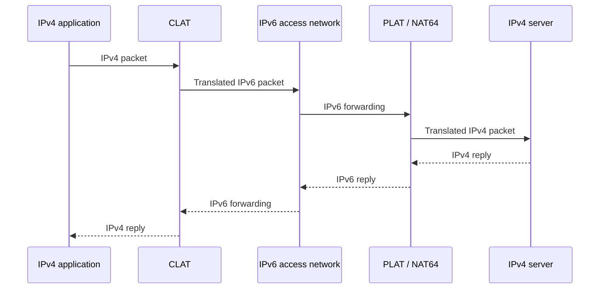

# 20. NAT64, DNS64, and 464XLAT

## Learning goals

- Trace IPv4 application traffic through CLAT and PLAT.
- Distinguish translation, DNS synthesis, and stateful versus stateless components.

**Builds on:** [Coexistence, encapsulation, and historical 6to4](19_tunnelling.md).

## Explanation

With **NAT64**, an IPv6 client sends to an IPv6 representation of an IPv4 destination. A translator forwards the communication into IPv4, commonly using a pool of IPv4 addresses and maintaining flow mappings.

**DNS64** can synthesize an AAAA response when a destination has an A record but no usable AAAA record. The synthesized IPv6 address directs traffic through NAT64. This helps applications using names, but an old application with an IPv4 literal or IPv4-only socket interface may still need another mechanism.

**464XLAT** adds a customer-side translator:

1. A legacy application sends IPv4 traffic through a local IPv4-facing interface.
2. The **CLAT** translates IPv4 into IPv6.
3. The access network carries the traffic natively as IPv6.
4. The provider's **PLAT**, a stateful NAT64 translator, converts it to IPv4 toward the destination.
5. Return traffic follows the corresponding translations in reverse.

The access network need not run IPv4 even though the application and remote server still use it. This is **translation, not tunnelling**: the network carries translated packets rather than an intact inner IPv4 header enclosed in an IPv6 packet. CLAT translation is stateless in the RFC 6877 architecture; the provider translator holds the relevant stateful mapping.

Mobile carriers use this architecture to support legacy applications over IPv6-only access. The source's suggestion that a reader is “almost certainly using it” on mobile is too strong: the actual deployment depends on carrier, device, and connection. The useful exercise is to inspect the network rather than assume its transition mechanism.

## Practice

No native IPv6 quiz questions are assigned. This teaching is retained for study and revision.

Check the [review queue](review.md) before scored practice; flagged questions retain their original keys. The [manifest](manifest.json) separates additional required lessons from optional background.

## Source

- [Lecture: 11. Coexistence and transition mechanisms](../../lectures/lecture_03_ipv6.md#11-coexistence-and-transition-mechanisms)

[Topic overview](README.md) · [Glossary](glossary.md) · [References](references.md) · [Previous lesson](19_tunnelling.md) · [Next lesson](21_operating_models.md)
