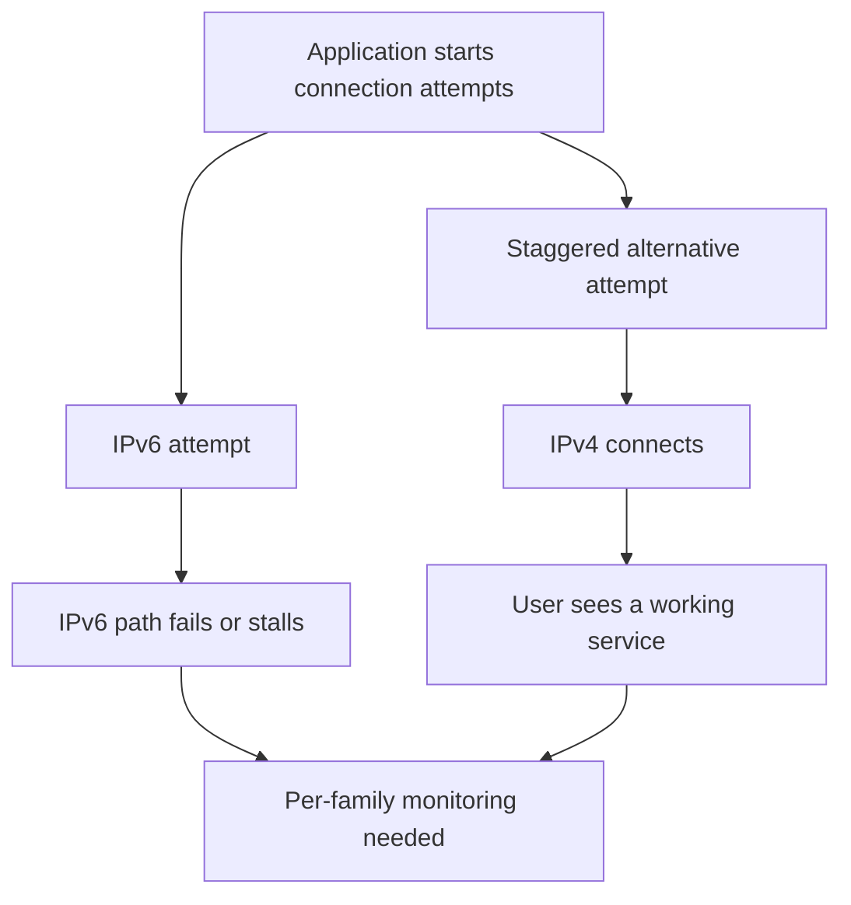

# 24. Happy Eyeballs and hidden path failures

## Learning goals

- Explain how successful fallback can hide a broken address family.
- Distinguish per-family monitoring from aggregate reachability and lost translation state.

**Builds on:** [NAT64, DNS64, and 464XLAT](20_nat64_and_464xlat.md), [Dual-stack, IPv6-mostly, and IPv6-only access](21_operating_models.md).

## Explanation

**Happy Eyeballs**, described in RFC 8305, reduces connection delays by trying alternative destination addresses and address families with controlled timing and concurrency. It does not necessarily launch exactly one IPv4 and one IPv6 connection at the identical instant.

If IPv6 is broken but IPv4 succeeds promptly, the user may see a successful connection. That protects usability while removing an obvious symptom of the IPv6 failure.

Dual stack permits independently failing paths. Aggregate “service reachable” monitoring can remain green while one family is consistently unusable. **Technical clarification:** failure is hidden only from observers that do not measure it. Operators can track family-specific reachability, latency, and fallback behaviour.

Translation adds another dependency: **mapping state at the provider edge**. Losing that state mid-connection can interrupt traffic even when both endpoints and the forwarding links remain available. The stateless CLAT and stateful PLAT should not be described as identical sources of this failure.

The wider lesson is that successful compatibility can postpone detection and repair. A system should distinguish “the user eventually connected” from “every intended path works.” The same distinction appears with extension headers: a specification and a working local implementation do not guarantee usability across the deployed path.

## Practice

No native IPv6 quiz questions are assigned. This teaching is retained for study and revision.

Check the [review queue](review.md) before scored practice; flagged questions retain their original keys. The [manifest](manifest.json) separates additional required lessons from optional background.

## Source

- [Lecture: 12. Deployment evidence and failure modes](../../lectures/lecture_03_ipv6.md#12-deployment-evidence-and-failure-modes)

[Topic overview](README.md) · [Glossary](glossary.md) · [References](references.md) · [Previous lesson](23_deployment_economics.md) · [Next lesson](25_worked_revision.md)
