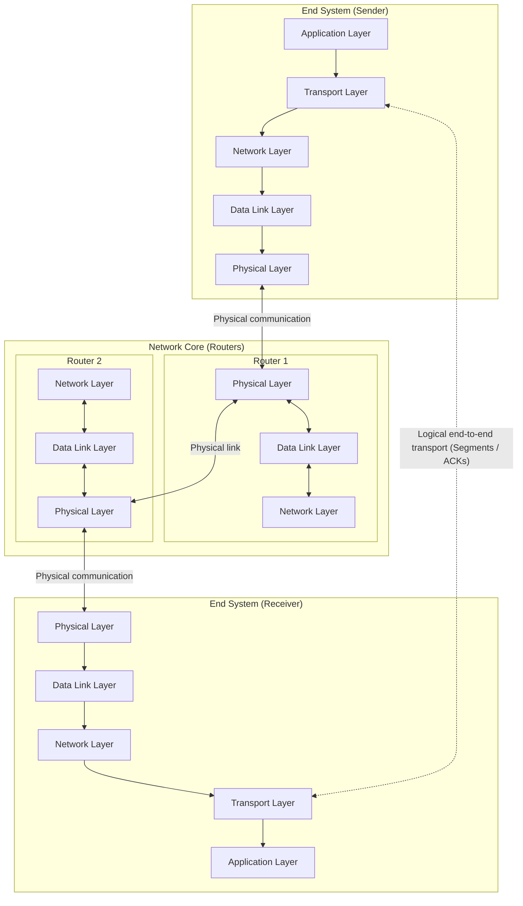

# 1. Layering and end-to-end transport

## Learning goals

- Distinguish logical transport communication from physical forwarding through routers.
- Name the five Internet protocol layers.

## Explanation

## 1. Internet Protocol Stack and Transport Layer Services

### 1.1 Layering: Logical vs. Physical Communication

The Internet protocol stack organizes networking functionality into five distinct layers, each providing services to the layer above it by relying on the layer below:

1. **Application layer:** Supports network applications and protocols such as FTP, SMTP, and HTTP.
2. **Transport layer:** Provides logical end-to-end communication between application processes running on different hosts using protocols such as TCP and UDP.
3. **Network layer:** Handles the routing of datagrams from source to destination across interconnected networks via IP and routing protocols.
4. **Link layer (Data Link):** Manages data transfer between neighboring network elements (e.g., between a host and a first-hop router, or between two adjacent routers) using protocols like PPP and Ethernet.
5. **Physical layer:** Transmits raw bits "on the wire" across the physical transmission medium.

Each layer is **distributed**: software or hardware "entities" implement the layer's functions at each node, performing local actions and exchanging messages with their peer entities at the same layer on remote nodes.

A crucial architectural distinction exists between **logical communication** and **physical communication**:

- **Physical communication** travels down the sender's protocol stack to the physical medium, traverses a series of intermediate switches and routers (which only process packets up to the link and network layers), and climbs up the receiver's stack.
- **Logical communication** at the transport layer makes it appear to application processes as if the two end systems are directly connected. Because intermediate routers do not implement the transport layer, **transport protocols run exclusively in the end systems**. The sending transport entity takes data from the application, encapsulates it with addressing and optional reliability metadata to form a **segment**, and sends the segment to its peer, optionally waiting for an acknowledgment (`ACK`) of receipt.

## Practice

No native TCP quiz questions are assigned. This teaching is retained for study and revision.

The [review queue](review.md) separates coverage from wording and supplementary scope. Mapped questions here need no additional required lessons; the [manifest](manifest.json) lists optional background. Original keys and manual tags are preserved.

## Source

- [Lecture: 1. Internet Protocol Stack and Transport Layer Services](../../lectures/lecture_04_tcp-ip.md#1-internet-protocol-stack-and-transport-layer-services)
- [Lecture: 1.1 Layering: Logical vs. Physical Communication](../../lectures/lecture_04_tcp-ip.md#11-layering-logical-vs-physical-communication)

[Topic overview](README.md) · [Glossary](glossary.md) · [References](references.md) · [Next lesson](02_tcp_udp_services.md)
