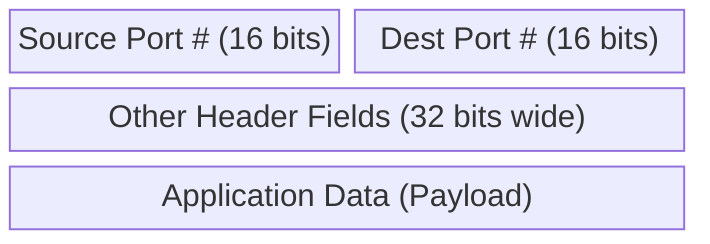
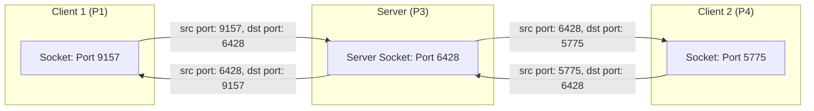
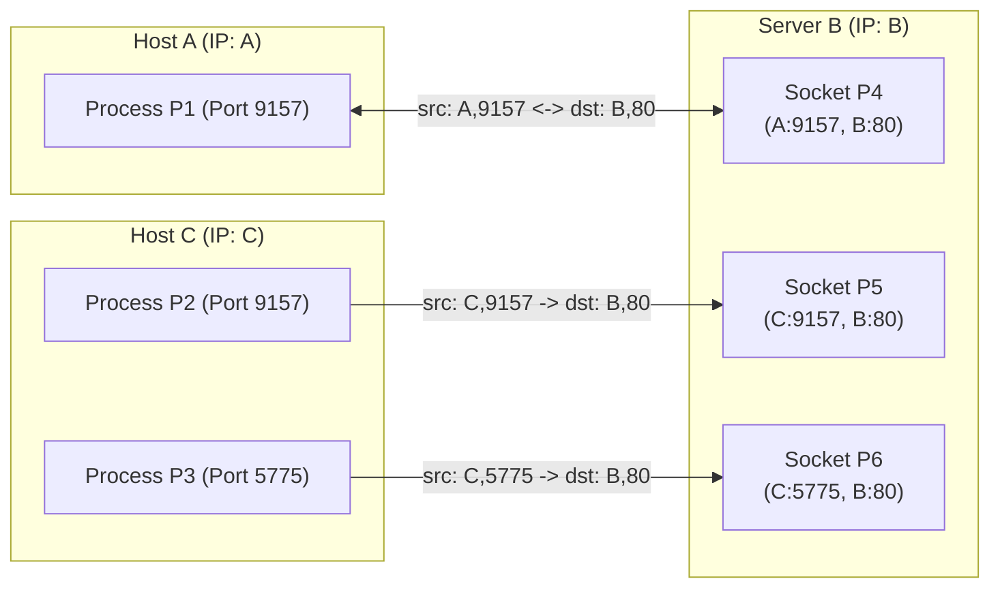

# 3. Ports, sockets, and demultiplexing

## Learning goals

- Explain how port numbers connect transport data to applications.
- Compare UDP demultiplexing with TCP four-tuple connection identity.

**Builds on:** [lesson 02](02_tcp_udp_services.md).

## Explanation

### 1.3 Addressing, Multiplexing, and Demultiplexing

A single host simultaneously runs multiple network processes. Because the network layer only delivers datagrams to the destination host (via IP address), the transport layer is responsible for routing data to the specific application process within that host through **sockets**.

- **Multiplexing at the sending host:** Gathering data chunks from different application sockets, enveloping each data chunk with transport header information (including port numbers), and passing the resulting segments to the network layer.
- **Demultiplexing at the receiving host:** Examining the header fields of incoming segments and delivering the payload to the correct socket.

Every TCP and UDP segment begins with a 32-bit word containing two 16-bit port numbers:

#### Connectionless Demultiplexing (UDP)

When a program creates a UDP socket, it binds the socket to a host-local 16-bit port number, for example:
`DatagramSocket mySocket1 = new DatagramSocket(12534);`

When creating a UDP datagram to send, the application must explicitly specify the **destination IP address** and **destination port number**. When a receiving host receives a UDP datagram, it inspects *only* the **destination port number** in the segment and directs the datagram to the socket bound to that port.

Consequently, **IP datagrams with the same destination IP address and destination port number, even if they originate from different source IP addresses and/or different source port numbers, will all be directed to the exact same UDP socket.**

#### Connection-Oriented Demultiplexing (TCP)

In contrast to UDP, a TCP socket is uniquely identified by a **4-tuple**:
1. **Source IP address**
2. **Source port number**
3. **Destination IP address**
4. **Destination port number**

When a TCP segment arrives, the receiver uses **all four values** to direct the segment to the appropriate socket. A server host can therefore support many simultaneous TCP sockets bound to the exact same local port (such as port `80` for a web server):
- Each active connection gets its own dedicated socket identified by its unique 4-tuple.
- Web servers create distinct sockets for each connecting client process, and under non-persistent HTTP, they even create a different socket for each individual request.

As shown above, three segments all destined to IP address `B` and destination port `80` are demultiplexed to three separate sockets (`P4`, `P5`, `P6`) because their source IP addresses or source port numbers differ.

---

## Practice

No native TCP quiz questions are assigned. This teaching is retained for study and revision.

The [review queue](review.md) separates coverage from wording and supplementary scope. Mapped questions here need no additional required lessons; the [manifest](manifest.json) lists optional background. Original keys and manual tags are preserved.

## Source

- [Lecture: 1.3 Addressing, Multiplexing, and Demultiplexing](../../lectures/lecture_04_tcp-ip.md#13-addressing-multiplexing-and-demultiplexing)

[Topic overview](README.md) · [Glossary](glossary.md) · [References](references.md) · [Previous lesson](02_tcp_udp_services.md) · [Next lesson](04_stop_and_wait.md)
