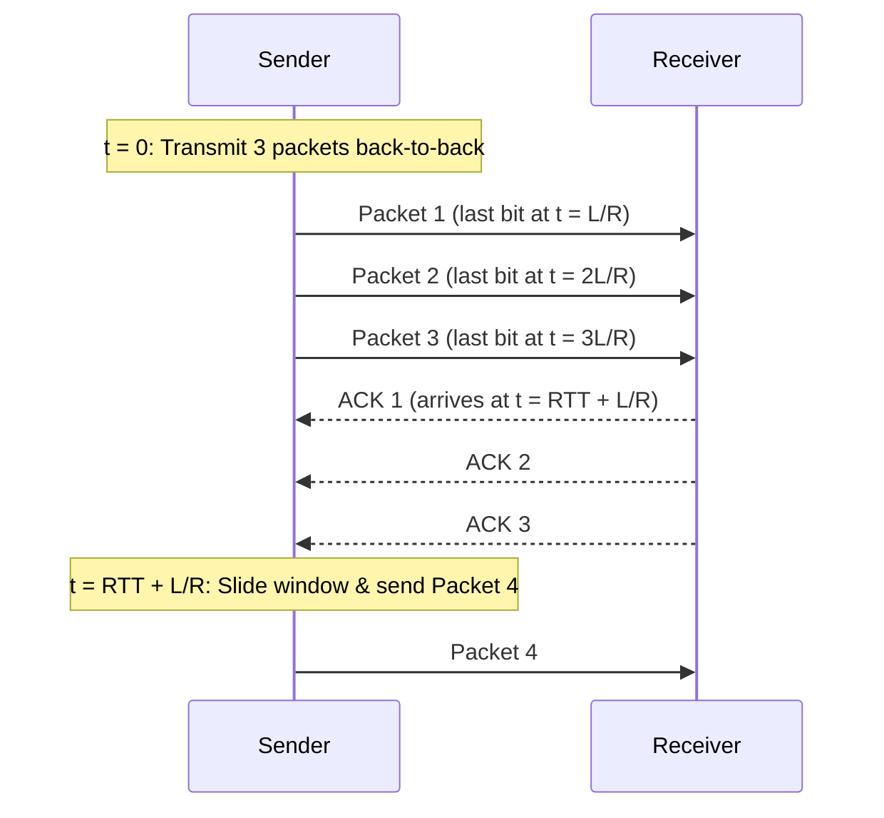

# 5. Pipelining and sliding windows

## Learning goals

- Explain why a sender benefits from multiple unacknowledged packets.
- Calculate the utilization improvement from a three-packet pipeline.

**Builds on:** [lesson 04](04_stop_and_wait.md).

## Explanation

### 2.2 Pipelined Protocols and Sliding Windows

To solve the low utilization problem of Stop-and-Wait, transport protocols use **pipelining** (also known as a **sliding window** protocol):
- The sender allows up to $N$ multiple "in-flight", yet-to-be-acknowledged segments simultaneously.
- **Optimal choice of window size $N$:** Ideally, $N$ should be large enough to allow the sender to transmit continuously throughout the entire round-trip transit time without stalling.
- **Error recovery:** Pipelining still requires acknowledgments and retransmissions. In case of an out-of-sequence error, a cumulative-ACK receiver acknowledges the **last correctly received in-order segment**.
- As acknowledgments arrive at the sender, the window of permissible sequence numbers **slides forward**.

For a sliding window of size $N = 3$ on the same $1\text{ Gbps}$, $30\text{ ms}$ RTT link, the sender transmits $3$ packets per cycle, increasing utilization by a factor of $3$:

$$U_{\text{sender}} = \frac{3 \cdot (L / R)}{\text{RTT} + L / R} = \frac{0.024\text{ ms}}{30.008\text{ ms}} \approx 0.08\%$$

## Practice

No native TCP quiz questions are assigned. This teaching is retained for study and revision.

The [review queue](review.md) separates coverage from wording and supplementary scope. Mapped questions here need no additional required lessons; the [manifest](manifest.json) lists optional background. Original keys and manual tags are preserved.

## Source

- [Lecture: 2.2 Pipelined Protocols and Sliding Windows](../../lectures/lecture_04_tcp-ip.md#22-pipelined-protocols-and-sliding-windows)

[Topic overview](README.md) · [Glossary](glossary.md) · [References](references.md) · [Previous lesson](04_stop_and_wait.md) · [Next lesson](06_byte_stream_window.md)
