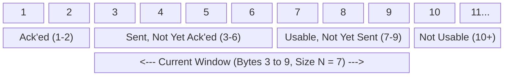

# 6. TCP byte numbers and the sender window

## Learning goals

- Identify acknowledged, outstanding, sendable, and unavailable byte ranges.
- Explain how a new cumulative ACK advances the sender window.

**Builds on:** [lesson 05](05_pipelining.md).

## Explanation

**Editorial clarification:** A new cumulative ACK advances the left edge because it acknowledges previously outstanding bytes. A duplicate ACK repeats that edge; it does not itself acknowledge new bytes. The byte trace in lesson 07 shows the sequence field identifying the first data byte of each illustrated segment, rather than counting packets. The finite-number wraparound rules are not explained by this window picture; Q003 remains a coverage gap.

### 2.3 TCP Byte-Stream Sliding Window

TCP implements its sliding window over a continuous stream of **byte positions** rather than discrete packet numbers. At any instant, the sender's byte sequence space is partitioned into four regions relative to the current window of size $N$:

1. **Already acknowledged (e.g., Bytes 1–2):** Bytes below `send_base` that have been sent and cumulatively acknowledged by the receiver.
2. **Sent, not yet acknowledged (e.g., Bytes 3–6):** In-flight bytes starting at `send_base` up to `nextseqnum - 1` for which the sender is awaiting an `ACK`.
3. **Usable, not yet sent (e.g., Bytes 7–9):** Bytes starting at `nextseqnum` that fall within the current window and can be transmitted immediately as soon as the application provides data.
4. **Outside the window / Not usable (e.g., Bytes 10+):** Bytes beyond the upper edge of the current window (`send_base + N`) that cannot be sent until the window slides forward upon receipt of new acknowledgments.

## Practice

- **Q007** in [quiz 04](../../quizzes/quiz_04_tcp.json); flags: `wording_issue`.

The [review queue](review.md) separates coverage from wording and supplementary scope. Mapped questions here need no additional required lessons; the [manifest](manifest.json) lists optional background. Original keys and manual tags are preserved.

## Source

- [Lecture: 2.3 TCP Byte-Stream Sliding Window](../../lectures/lecture_04_tcp-ip.md#23-tcp-byte-stream-sliding-window)

[Topic overview](README.md) · [Glossary](glossary.md) · [References](references.md) · [Previous lesson](05_pipelining.md) · [Next lesson](07_rtt_and_timeouts.md)
