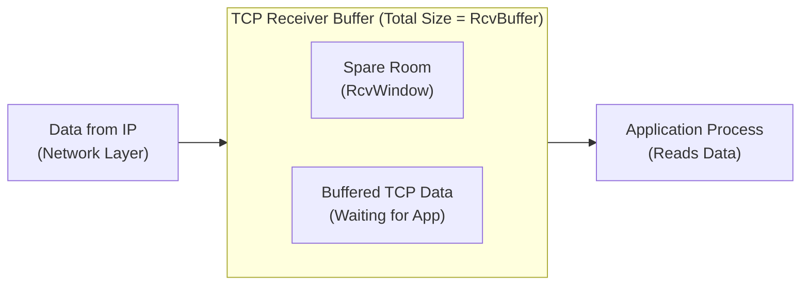

# 8. Flow control and the receive window

## Learning goals

- Distinguish receive-buffer capacity from free advertised space.
- Explain how the advertised receive window limits outstanding data.

**Builds on:** [lesson 06](06_byte_stream_window.md).

## Explanation

### 2.5 TCP Flow Control

Besides reliability, acknowledgments in TCP enable **flow control**: preventing a fast sender from swamping a slow receiver's finite buffer memory.

- The receiver allocates a receive buffer of total size `RcvBuffer`. As segments arrive from IP, they are placed in `RcvBuffer` until the application process reads them.
- The amount of free, spare room remaining in the buffer is called `RcvWindow`.
- **Dynamic sliding window:** The receiver explicitly informs the sender of its dynamically changing free buffer space by placing the current value of `RcvWindow` in the Window field of every outgoing TCP segment header.
- The sender constrains the amount of transmitted, unacknowledged data (`LastByteSent - LastByteAcked`) to remain strictly less than or equal to the most recently received `RcvWindow`, ensuring it never overruns the receiver's buffer.

---

## Practice

- **Q006** in [quiz 04](../../quizzes/quiz_04_tcp.json).

The [review queue](review.md) separates coverage from wording and supplementary scope. Mapped questions here need no additional required lessons; the [manifest](manifest.json) lists optional background. Original keys and manual tags are preserved.

## Source

- [Lecture: 2.5 TCP Flow Control](../../lectures/lecture_04_tcp-ip.md#25-tcp-flow-control)

[Topic overview](README.md) · [Glossary](glossary.md) · [References](references.md) · [Previous lesson](07_rtt_and_timeouts.md) · [Next lesson](09_congestion_goals.md)
