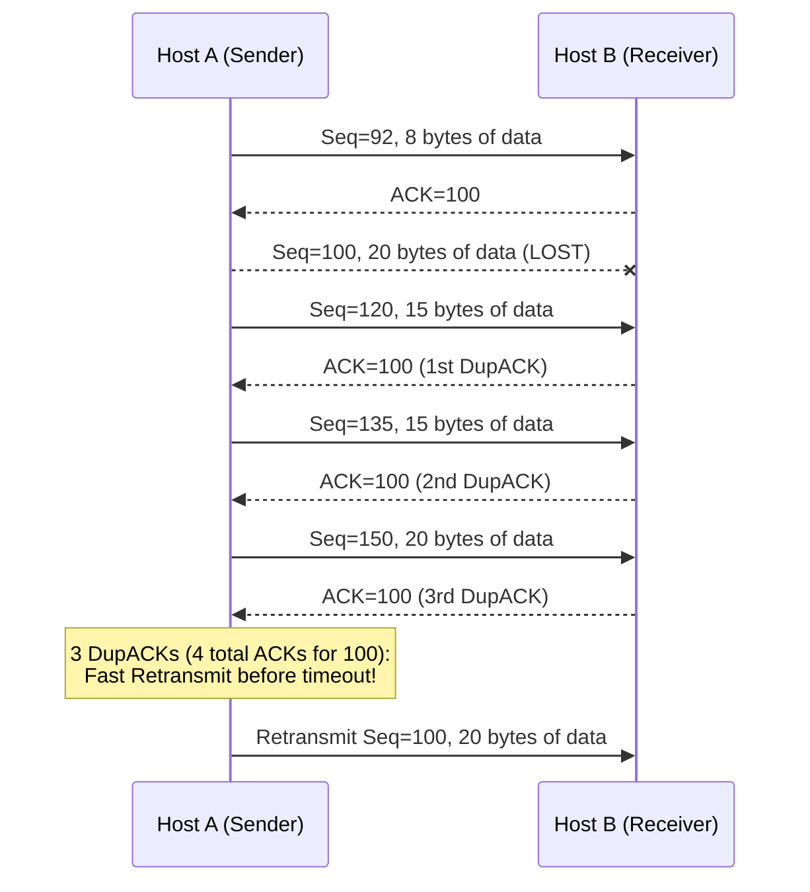

# 13. Fast retransmit and duplicate ACKs

## Learning goals

- Explain why a gap produces repeated cumulative ACK numbers.
- Apply the three-duplicate-ACK fast-retransmit rule and its reordering rationale.

**Builds on:** [lesson 06](06_byte_stream_window.md), [lesson 07](07_rtt_and_timeouts.md), [lesson 12](12_slow_start_tahoe.md).

## Explanation

**Editorial clarification:** The three-duplicate-ACK threshold tolerates some data reordering; it is an inference of loss, not proof. Severe reordering can still mislead a sender. This lesson does not explain delayed-ACK policy, and it does not resolve routing Q048's statement about reordered acknowledgments or its missing mitigation option.

### 3.4 Fast Retransmit and Fast Recovery (TCP Reno)

#### Fast Retransmit

Waiting for a retransmission timeout (RTO) introduces a long idle delay before resending a lost packet. However, because a pipelined sender transmits many segments back-to-back, if a single segment in the middle of a window is lost, subsequent segments with higher sequence numbers will still arrive at the receiver.

In TCP, whenever a receiver receives an out-of-order segment with a sequence number higher than the next expected in-order byte, it immediately sends a **duplicate ACK** repeating the byte number it is still waiting for.

- **Rule:** If the sender receives **3 duplicate ACKs** for the same data (meaning 4 identical ACKs in total: the original ACK plus 3 duplicates), it assumes the segment immediately following the ACKed data was lost and triggers **Fast Retransmit**, resending the missing segment immediately before the retransmission timer expires.
- **Why wait for 3 duplicate ACKs instead of 1 or 2?** Packets in an IP network can be slightly **reordered** in flight without being lost. A single out-of-order packet swap produces 1 or 2 duplicate ACKs; waiting for 3 duplicate ACKs distinguishes genuine packet loss from minor packet reordering.

## Practice

- **Q009** in [quiz 04](../../quizzes/quiz_04_tcp.json).

The [review queue](review.md) separates coverage from wording and supplementary scope. Mapped questions here need no additional required lessons; the [manifest](manifest.json) lists optional background. Original keys and manual tags are preserved.

## Source

- [Lecture: 3.4 Fast Retransmit and Fast Recovery (TCP Reno)](../../lectures/lecture_04_tcp-ip.md#34-fast-retransmit-and-fast-recovery-tcp-reno)

[Topic overview](README.md) · [Glossary](glossary.md) · [References](references.md) · [Previous lesson](12_slow_start_tahoe.md) · [Next lesson](14_reno_fast_recovery.md)
