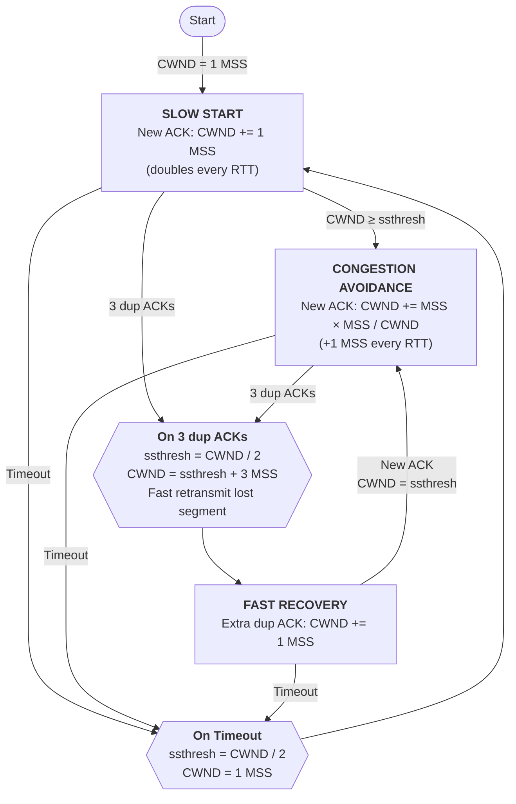

# 14. Reno fast recovery and out-of-order buffering

## Learning goals

- Trace Reno threshold, inflation, and deflation after three duplicate ACKs.
- Contrast fast recovery with timeout slow start and explain the role of buffered data.

**Builds on:** [lesson 12](12_slow_start_tahoe.md), [lesson 13](13_fast_retransmit.md).

## Explanation

**Editorial clarification:** Reno bypasses slow start on the three-duplicate-ACK fast-recovery path. A timeout still resets the congestion window and enters slow start. Buffered out-of-order data can then be covered by one cumulative ACK when the gap is filled; discarding that data instead would require sending it again. This comparison follows the buffering mechanism described below and supports Routing Q049.

#### Fast Recovery (TCP Reno)

In **TCP Reno** (1990), the receipt of 3 duplicate ACKs is treated as a milder congestion signal than a timeout: the fact that 3 duplicate ACKs arrived proves that segments are still flowing through the network! Therefore, instead of resetting $\text{CWND} = 1$ and entering Slow Start (like Tahoe), Reno uses **Fast Recovery** to keep the pipe full:

The exact steps of **Fast Recovery** upon receiving 3 duplicate ACKs are:
1. **Halve threshold:** Set $\text{ssthresh} = \frac{\text{CWND}}{2}$.
2. **Inflate CWND by 3:** Set $\text{CWND} = \text{ssthresh} + 3\text{ MSS}$. Why $+3$? Because the 3 duplicate ACKs imply that 3 out-of-order segments have already left the network and are buffered at the receiver, so inflating `CWND` by 3 accounts for those segments and prevents the sender from reducing its window too aggressively.
3. **Increment on additional DupACKs:** For each additional duplicate ACK received while in Fast Recovery, increment $\text{CWND} \leftarrow \text{CWND} + 1\text{ MSS}$ (reflecting that one more packet has left the network pipe), and transmit a new segment if allowed by the inflated window.
4. **Deflate on New ACK:** When a new (non-duplicate) ACK finally arrives acknowledging the retransmitted segment (and all buffered out-of-order segments), set $\text{CWND} = \text{ssthresh}$ and return directly to the **Congestion Avoidance** phase, completely bypassing Slow Start.

For example, in the textbook trace (slide 66), `ssthresh` is initially $28$. `CWND` grows exponentially in Slow Start from $1$ to $28$ (at $\text{RTT} = 5$), then grows linearly in Congestion Avoidance up to $\text{CWND} = 36$ (at $\text{RTT} = 13$), where 3 duplicate ACKs arrive. Reno sets $\text{ssthresh}_{\text{new}} = \frac{36}{2} = 18$, sets $\text{CWND}_{\text{new}} = 18 + 3 = 21$ (at $\text{RTT} = 14$), increments `CWND` to $23$ as two more DupACKs arrive (at $\text{RTT} = 16$), and upon receiving the ACK for the retransmitted segment at $\text{RTT} = 17$, deflates $\text{CWND} = \text{ssthresh}_{\text{new}} = 18$ and resumes linear Congestion Avoidance.

#### Summary of Differences: Fast Retransmit vs. Fast Recovery
- **Objective:** Fast Retransmit aims to quickly retransmit a lost packet detected via 3 duplicate ACKs without waiting for RTO. Fast Recovery aims to manage and adjust `CWND` after Fast Retransmit to maintain data flow and adapt to network conditions without dropping `CWND` to $1$.
- **Timing:** Fast Retransmit triggers *immediately* upon the 3rd duplicate ACK. Fast Recovery *follows* Fast Retransmit and governs window size until a new cumulative ACK arrives.
- **Impact on `CWND`:** Fast Retransmit itself is the retransmission action and does not directly govern the window trajectory; Fast Recovery halves `CWND` (plus $3\text{ MSS}$), inflates it per DupACK, and deflates it to `ssthresh` upon recovery.

## Practice

- **Q015** in [quiz 04](../../quizzes/quiz_04_tcp.json); flags: `wording_issue`.
- **Q016** in [quiz 04](../../quizzes/quiz_04_tcp.json).
- **Routing Q049** in [quiz 01](../../quizzes/quiz_01_routing.json), canonical record `routing-q049`. No additional lesson is required for this buffering comparison.

The [review queue](review.md) separates coverage from wording and supplementary scope. Mapped questions here need no additional required lessons; the [manifest](manifest.json) lists optional background. Original keys and manual tags are preserved.

## Source

- [Lecture: Fast Recovery (TCP Reno)](../../lectures/lecture_04_tcp-ip.md#fast-recovery-tcp-reno)
- [Lecture: Summary of Differences: Fast Retransmit vs. Fast Recovery](../../lectures/lecture_04_tcp-ip.md#summary-of-differences-fast-retransmit-vs-fast-recovery)

[Topic overview](README.md) · [Glossary](glossary.md) · [References](references.md) · [Previous lesson](13_fast_retransmit.md) · [Next lesson](15_classical_variants.md)
