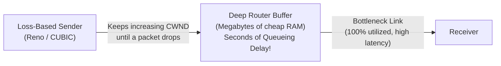

# 18. Bufferbloat, CoDel, and FQ-CoDel

## Learning goals

- Explain why deep queues can preserve throughput while harming latency.
- Distinguish CoDel delay-based queue management from FQ-CoDel per-flow isolation.

**Builds on:** [lesson 10](10_congestion_feedback.md), [lesson 17](17_cubic.md).

## Explanation

### 4.1 Bufferbloat and Active Queue Management (CoDel & FQ-CoDel)

#### The Bufferbloat Problem

Loss-based congestion control algorithms (Tahoe, Reno, NewReno, CUBIC) share a structural flaw: **they only know a link is full when a packet is dropped, which means they deliberately fill whatever router buffer they find.**

As memory became cheap, router and switch manufacturers installed **deep buffers**. When a loss-based TCP flow traverses a router with a massive buffer, it continues increasing `CWND` until that entire buffer is full before experiencing a single drop. The result is **bufferbloat**:
- **Throughput stays fine** (the bottleneck link is $100\%$ utilized).
- **Latency collapses:** Packets sit in router queues for hundreds of milliseconds or even **seconds** of queueing delay, ruining interactive applications like voice calls, gaming, and web browsing.
- *Lesson:* More memory made the Internet slower, even though the TCP protocol was working exactly as designed.

#### Active Queue Management (AQM): Managing the Queue Instead

Because loss-based endpoints cannot detect that they are filling a deep buffer until it overflows, the buffer itself must intervene. **Active Queue Management (AQM)** moves the fix from the endpoint to the middle of the network:

1. **CoDel (Controlled Delay):** Instead of dropping packets based on *how many* packets are in the queue (queue length), CoDel tracks **sojourn time**—*how long* packets have been sitting in the queue. When minimum queueing delay exceeds a target threshold over an interval, CoDel begins dropping (or ECN-marking) packets to signal the sender to back off while the queue is still short.
2. **FQ-CoDel (Flow Queue CoDel):** Combines CoDel with **per-flow queueing**. Each network flow gets its own separate sub-queue scheduled fairly, ensuring that a single bulk file transfer cannot build a standing queue that starves or delays an interactive flow (such as SSH, DNS, or VoIP).

## Practice

- **Q024** in [quiz 04](../../quizzes/quiz_04_tcp.json).

The [review queue](review.md) separates coverage from wording and supplementary scope. Mapped questions here need no additional required lessons; the [manifest](manifest.json) lists optional background. Original keys and manual tags are preserved.

## Source

- [Lecture: 4.1 Bufferbloat and Active Queue Management (CoDel & FQ-CoDel)](../../lectures/lecture_04_tcp-ip.md#41-bufferbloat-and-active-queue-management-codel--fq-codel)

[Topic overview](README.md) · [Glossary](glossary.md) · [References](references.md) · [Previous lesson](17_cubic.md) · [Next lesson](19_bbr.md)
