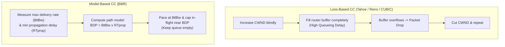

# 19. BBR path models and fairness caveats

## Learning goals

- Contrast bottleneck-bandwidth and propagation-delay modeling with loss-based growth.
- Retain the source-dated standardization and empirical fairness qualifications.

**Builds on:** [lesson 17](17_cubic.md), [lesson 18](18_bufferbloat_aqm.md).

## Explanation

**Source context:** The July 2026 draft revision/status and PAM 2024 findings below are retained as source-reported, dated claims. They have not been independently authenticated here. The queue-free BDP picture expresses the model's aim, not guaranteed zero queueing or a full specification of every BBR version.

### 4.2 Model-Based Congestion Control: BBR and BBRv3

#### Asking a Different Question

Developed by Google, **BBR (Bottleneck Bandwidth and Round-trip propagation time)** abandons the loss-based paradigm entirely:
- **Loss-based CC asks:** *"Has something been dropped yet?"* (Reacting to failure after filling the queue.)
- **BBR asks:** *"What is the bottleneck bandwidth ($B_{\text{tlBw}}$), and what is the minimum propagation RTT ($\text{RT}_{\text{prop}}$)?"*

Instead of increasing `CWND` until buffers overflow, BBR continuously measures the maximum delivery rate and minimum RTT to build an explicit **model of the network path**. It then paces packets at the estimated bottleneck bandwidth and caps in-flight data near the **Bandwidth-Delay Product ($\text{BDP} = B_{\text{tlBw}} \times \text{RT}_{\text{prop}}$)**, aiming to keep the bottleneck link $100\%$ utilized while **not filling the router queue at all**.

#### BBR's Standardization Status and Fairness Controversy

- **Standardization status:** As of July 2026, **BBRv3** is specified in IETF draft `draft-ietf-ccwg-bbr` (revision 06). Despite being widely deployed across Google's production infrastructure for nine years and three major versions, BBR remains an **Experimental** draft rather than a finalized standard—demonstrating that *"widely deployed"* and *"not yet standardised"* are compatible states on the modern Internet. Notably, the BBRv3 draft specifies **no ECN response**, which remains an active open question in the working group rather than an oversight.
- **Does BBR play fair?** Google designed BBRv3 to fix fairness issues observed in BBRv1 and BBRv2. However, an independent empirical evaluation presented at **PAM 2024** (by researchers at MPI-INF and VU Amsterdam) tested this claim and found:
  1. **Unfairness toward CUBIC in shallow buffers:** BBRv3 retains BBRv1-like aggressiveness when competing against CUBIC in routers with shallow buffers, starving CUBIC flows.
  2. **RTT bias:** A persistent bias favoring **long-RTT flows** over short-RTT flows remains.
  - *Takeaway:* Measured empirical behavior contradicts the optimistic deployment narrative.

## Practice

- **Q020** in [quiz 04](../../quizzes/quiz_04_tcp.json).

The [review queue](review.md) separates coverage from wording and supplementary scope. Mapped questions here need no additional required lessons; the [manifest](manifest.json) lists optional background. Original keys and manual tags are preserved.

## Source

- [Lecture: 4.2 Model-Based Congestion Control: BBR and BBRv3](../../lectures/lecture_04_tcp-ip.md#42-model-based-congestion-control-bbr-and-bbrv3)

[Topic overview](README.md) · [Glossary](glossary.md) · [References](references.md) · [Previous lesson](18_bufferbloat_aqm.md) · [Next lesson](20_ecn.md)
