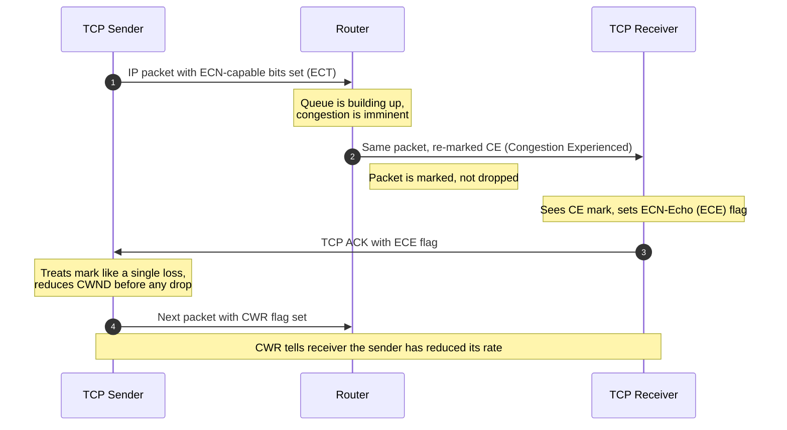

# 20. Explicit Congestion Notification

## Learning goals

- Trace ECN-capable transmission, CE marking, ECE feedback, and CWR response.
- Explain how congestion can be signaled without dropping the marked packet.

**Builds on:** [lesson 10](10_congestion_feedback.md), [lesson 18](18_bufferbloat_aqm.md).

## Explanation

### 4.3 Explicit Congestion Notification (ECN) and L4S

#### Classical ECN

First proposed by Sally Floyd in 1994, **Explicit Congestion Notification (ECN)** allows routers to signal impending congestion *before* buffers overflow and packets are dropped:

1. **ECN Bits in IP Header:** The sender marks two ECN bits in the IP header to indicate that the transport endpoints are ECN-capable.
2. **Router Marking:** When a router experiences building congestion, it sets the ECN bits in the IP header to "Congestion Experienced" (`CE`) instead of dropping the packet.
3. **Receiver Notification:** When the marked packet arrives at the receiver, the TCP receiver reliably informs the TCP sender of the congestion via flags in the returning TCP `ACK` header.
4. **Sender Response:** The TCP sender reacts proactively—treating the ECN mark like a single packet loss and cutting its sending rate before any actual packet drop occurs.

## Practice

- **Q019** in [quiz 04](../../quizzes/quiz_04_tcp.json).

The [review queue](review.md) separates coverage from wording and supplementary scope. Mapped questions here need no additional required lessons; the [manifest](manifest.json) lists optional background. Original keys and manual tags are preserved.

## Source

- [Lecture: 4.3 Explicit Congestion Notification (ECN) and L4S](../../lectures/lecture_04_tcp-ip.md#43-explicit-congestion-notification-ecn-and-l4s)

[Topic overview](README.md) · [Glossary](glossary.md) · [References](references.md) · [Previous lesson](19_bbr.md) · [Next lesson](21_l4s.md)
