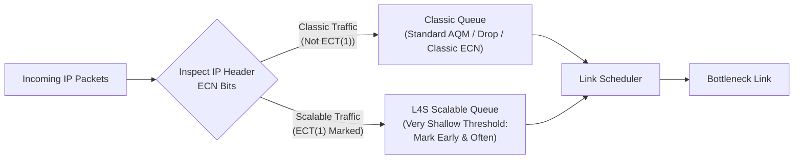

# 21. L4S queues, feedback, and deployment claims

## Learning goals

- Explain the ECT(1) distinction and dual-queue architecture.
- Preserve the bounded source-reported latency gains and measurement context.

**Builds on:** [lesson 20](20_ecn.md).

## Explanation

**Source context:** Deployment assertions (including the comparison with ASPA) and the March 2026 field-study numbers below are source statements, not freshly verified adoption measurements. Keep the source's bounded, workload-dependent result; do not treat “today” as a continuously updated status.

#### L4S: Low Latency, Low Loss, Scalable Throughput

While classical ECN avoided packet drops, classical TCP still reacted to an ECN mark by cutting `CWND` drastically (e.g., by half or $30\%$), requiring a substantial buffer to avoid underutilizing the link. Standardized in **RFC 9330, RFC 9331, and RFC 9332**, **L4S (Low Latency, Low Loss, Scalable Throughput)** redesigns congestion signaling from the ground up to support real-time interactive applications (cloud gaming, video conferencing, VR):

- **Dual-Queue Architecture:** L4S routers maintain **two separate queues** isolated from one another: one for **classic traffic** (Reno/CUBIC) and one for **scalable traffic** (such as TCP Prague or L4S-enabled QUIC), separated by the **`ECT(1)`** codepoint marking in the IP header.
- **Mark early and often:** In the L4S queue, the router marks packets with ECN **early and frequently** as soon as a tiny queue begins to form. Scalable senders adjust their sending rate in fine-grained steps proportional to the fraction of marked packets, reacting *before* any significant queue builds.

#### Real-World Deployment and Empirical Performance of L4S

Unlike some IETF standards that remain unused on paper (such as ASPA in routing security), **L4S is actively deployed in consumer networks today**:
- **Comcast** has rolled out L4S across its production broadband network.
- **Apple** enabled L4S support across its operating systems starting with **iOS 17** and **macOS Sonoma**.

**What do honest measurements show?** A **March 2026 field study** across **83 households** comprising roughly **120,000 controlled experiments** evaluated L4S in the wild:
- **Up to $\sim 25\%$ tail-latency reduction** for interactive traffic.
- **Bounded, situational gains:** Minimal gains were observed for some workloads, with benefits concentrated primarily during **peak usage hours** when access links experience contention. Thus, L4S represents a real, measurable engineering improvement, but one that is bounded and situational rather than a universal panacea.

## Practice

No native TCP quiz questions are assigned. This teaching is retained for study and revision.

The [review queue](review.md) separates coverage from wording and supplementary scope. Mapped questions here need no additional required lessons; the [manifest](manifest.json) lists optional background. Original keys and manual tags are preserved.

## Source

- [Lecture: L4S: Low Latency, Low Loss, Scalable Throughput](../../lectures/lecture_04_tcp-ip.md#l4s-low-latency-low-loss-scalable-throughput)
- [Lecture: Real-World Deployment and Empirical Performance of L4S](../../lectures/lecture_04_tcp-ip.md#real-world-deployment-and-empirical-performance-of-l4s)

[Topic overview](README.md) · [Glossary](glossary.md) · [References](references.md) · [Previous lesson](20_ecn.md) · [Next lesson](22_quic.md)
