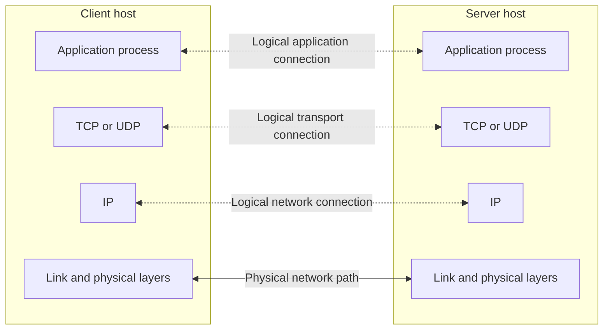

# 1. The socket boundary and protocol stack

## Learning goals

- Locate the socket API between application processes and the transport stack.
- Distinguish logical peer communication from the physical data path.

## Explanation

**Editorial clarification:** The source describes an application-facing API that crosses into the kernel through system calls. Moving library-facing code into user space does not by itself grant device-driver access or replace the kernel TCP/IP stack; Q001 needs review.

## 1. Introduction to the Client-Server Model and the Socket Interface

### 1.1 Layered Communication: User Processes vs. Kernel Protocol Stack

Many network applications use **clients** and **servers** communicating through an Application Programming Interface (API) known as **sockets**. Created in the early 1980s as part of the original Berkeley Software Distribution (4.2BSD Unix), the sockets interface provides a user-level interface to the kernel's networking stack and underpins many Internet applications.

Lines show layering and connectivity, not one-way traffic. Actual data moves down one stack, across the network, and up the other; the reverse direction is also available.

When comparing the 7-layer **OSI model** with the **Internet protocol suite**:

* **User process (upper layers):** The application, presentation, and session layers (OSI layers 5–7) are folded into a single **application** layer running in user space, which handles all application-specific details.
* **Kernel protocol stack (lower layers):** The transport layer (TCP, UDP — OSI layer 4), network layer (IPv4, IPv6 — OSI layer 3), and datalink/physical layers (device drivers and hardware — OSI layers 1–2) typically run in the kernel or associated device hardware. User-space transports and kernel-bypass designs are important exceptions, discussed later.
* **The Socket / XTI boundary:** The sockets API (and historically XTI) sits directly on the boundary between the user process (layer 5–7) and the kernel transport layer (layer 4). While two endpoints communicate logically at each peer layer, the **actual flow of data** descends through the client's kernel stack, traverses Local Area Networks (LANs) and Wide Area Network (WAN) routers, and ascends the server's kernel stack.

## Practice

- **Q001** in [quiz 05](../../quizzes/quiz_05_socket_api.json); flags: `wording_issue`; also requires [lesson 12](12_socket_call.md).

Check the [review queue](review.md) before scored practice. A lesson link can teach the reasoning that exposes a false premise or key; it does not endorse that key. Optional background is listed separately in the [manifest](manifest.json).

## Source

- [Lecture: 1. Introduction to the Client-Server Model and the Socket Interface](../../lectures/lecture_05_socket-api.md#1-introduction-to-the-client-server-model-and-the-socket-interface)

[Topic overview](README.md) · [Glossary](glossary.md) · [References](references.md) · [Next lesson](02_clients_and_socket_pairs.md)
