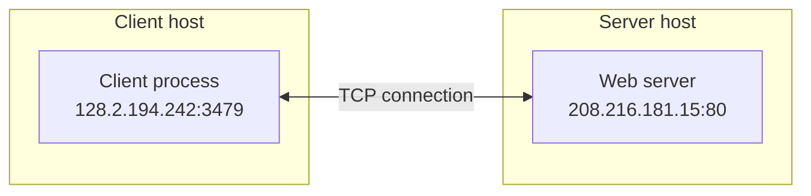

# 2. Clients, servers, and socket pairs

## Learning goals

- Explain sockets as an API, a system call, and a descriptor.
- Identify the four endpoint values defining a TCP connection.

**Builds on:** [lesson 01](01_socket_boundary.md).

## Explanation

### 1.2 Client-Server Paradigm, Sockets, and Connection 4-Tuples

In the client-server model, a **server process** manages some resource (such as files, an email spool, a terminal, or compute cycles) and provides a service by manipulating that resource on behalf of one or more **client processes**:

1. The client sends a request to the server.
2. The server receives and handles the request by accessing or manipulating its managed resource.
3. The server sends a response back to the client.
4. The client receives and handles the response.

*(Note: Clients and servers are software processes—not necessarily distinct physical machines—and can run on the same host or on different hosts).*

#### What is a Socket?

The term "socket" is used in three related ways in network programming:
1. **The Sockets API:** The programming interface itself.
2. **The `socket()` function:** The system call within that API used to create an endpoint.
3. **The socket endpoint/descriptor:**
   * **To the kernel**, a socket is an endpoint of communication.
   * **To an application**, a socket is a **file descriptor** (a small integer) that lets the application read from and write to the network.

Because Unix models all I/O devices—including networks—as files, clients and servers communicate with one another simply by reading from and writing to socket descriptors using system calls. The primary distinction between regular file I/O and socket I/O is how the application "opens" and configures the socket descriptor, as well as the transient, byte-stream behavior of network buffers.

#### Communication Paradigms and the Connection Socket Pair

The Internet protocol suite provides two main transport paradigms for client-server communication:

* **Datagrams (`SOCK_DGRAM`):** Unreliable, connectionless packet delivery using the **UDP** protocol (illustrated in languages like Java via `DatagramSocket()`, where each datagram explicitly carries the destination `(hostid, port)`).
* **Connections (`SOCK_STREAM`):** Point-to-point, **full-duplex** (two-way simultaneous communication), reliable byte-stream channels using the **TCP** protocol.

Within a given networking context, a TCP connection is identified by a **connection socket pair** (a 4-tuple consisting of the client socket address and the server socket address):

```math
\{\text{client\_IP}:\text{client\_port},\ \text{server\_IP}:\text{server\_port}\}
```

**Editorial layout repair:** The source labels clipped in the lesson preview. The same hosts and two-way connection are retained below, with multiline node labels and the full endpoint details in the table.



| Endpoint | IP address | Port | Port role |
| --- | --- | --- | --- |
| Client process | `128.2.194.242` | `3479` | Ephemeral client port |
| Web server process | `208.216.181.15` | `80` | Well-known HTTP service port |

The connection socket pair is `{128.2.194.242:3479, 208.216.181.15:80}`. The two-way arrow represents the full-duplex TCP connection.

How does a client locate and connect to a server?
* **The IP address** in the server socket address identifies the destination host (more precisely, a specific network interface adaptor on that host).
* **The well-known port number** in the server socket address identifies the specific service—and thus implicitly identifies the server process performing that service on the host.

## Practice

No native socket API quiz questions are assigned. This teaching is retained for study and revision.

Check the [review queue](review.md) before scored practice. A lesson link can teach the reasoning that exposes a false premise or key; it does not endorse that key. Optional background is listed separately in the [manifest](manifest.json).

## Source

- [Lecture: 1.2 Client-Server Paradigm, Sockets, and Connection 4-Tuples](../../lectures/lecture_05_socket-api.md#12-client-server-paradigm-sockets-and-connection-4-tuples)

[Topic overview](README.md) · [Glossary](glossary.md) · [References](references.md) · [Previous lesson](01_socket_boundary.md) · [Next lesson](03_services_and_ports.md)
