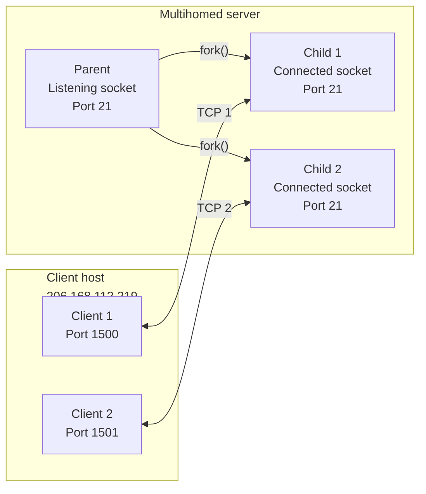

# 4. Concurrent connections on one server port

## Learning goals

- Explain wildcard listening and connected socket identities.
- Distinguish clients sharing a local server port using the complete four-tuple.

**Builds on:** [lesson 02](02_clients_and_socket_pairs.md), [lesson 03](03_services_and_ports.md).

## Explanation

**Editorial clarification:** Multiple connected sockets sharing a server port have different complete connection identities. This is distinct from two independent listeners requesting the same local address and port.

#### Concurrent Servers, Multihomed Hosts, and 4-Tuple Demultiplexing

Consider how TCP uses the 4-tuple socket pair to distinguish between a listening socket and multiple concurrent client connections on a **multihomed server host** that has two IP addresses (`12.106.32.254` and `192.168.42.1`):

1. **Passive Open (Listening Socket):** The FTP server starts and performs a passive open on its well-known port `21` using the wildcard IP address (`INADDR_ANY`, denoted `*`). Its socket pair is `{*:21, *:*}`, indicating that it accepts incoming connection requests arriving on *any* local network interface (`1st *`) addressed to port `21`, from *any* foreign client IP and port (`*:*`).
2. **First Client Connection and `fork()`:** A client on host `206.168.112.219` allocates ephemeral port `1500` and connects to the server's `12.106.32.254` interface on port `21`. When the server accepts the connection, it calls `fork()` to spawn a child process to handle the client:
   * The parent retains the **listening socket** `{*:21, *:*}`.
   * The child receives the **connected socket** `{12.106.32.254:21, 206.168.112.219:1500}`. Notice that the connected socket uses the **exact same local port (`21`)** as the listening socket, and its local IP address (`12.106.32.254`) is now filled in based on the interface through which the connection arrived.
3. **Second Concurrent Client Connection:** Suppose a second client process on the same client host (`206.168.112.219`) connects to the same server (`12.106.32.254:21`). The client's TCP stack assigns the second client an unused ephemeral port (`1501`), and the server forks a second child process.

**Editorial layout repair:** The source's long labels are wrapped or shortened below. The table preserves the complete local/remote socket pairs for each process.

| Process | Local endpoint | Remote endpoint |
| --- | --- | --- |
| Client 1 | `206.168.112.219:1500` | `12.106.32.254:21` |
| Client 2 | `206.168.112.219:1501` | `12.106.32.254:21` |
| Server parent (listening socket) | `*:21` | `*:*` |
| Server child 1 (TCP 1) | `12.106.32.254:21` | `206.168.112.219:1500` |
| Server child 2 (TCP 2) | `12.106.32.254:21` | `206.168.112.219:1501` |

The server's interfaces are `12.106.32.254` and `192.168.42.1`; both illustrated connections use the first address. `*` denotes a wildcard. Each row's local and remote endpoints form that process's socket pair. The `fork()` arrows retain the parent/child relationship, and the two-way TCP arrows show each client's connection to its corresponding child.

**Crucial Demultiplexing Rule:** Because the listening socket, `child1`, and `child2` are *all* bound to local port `21`, **TCP cannot demultiplex incoming segments by looking solely at the destination port number.** The kernel's TCP stack must inspect **all four elements in the socket pair** to route an arriving data segment to the connected socket in `child1` or `child2`, and route a new incoming `SYN` to the listening socket in the parent.

## Practice

No native socket API quiz questions are assigned. This teaching is retained for study and revision.

Check the [review queue](review.md) before scored practice. A lesson link can teach the reasoning that exposes a false premise or key; it does not endorse that key. Optional background is listed separately in the [manifest](manifest.json).

## Source

- [Lecture: Concurrent Servers, Multihomed Hosts, and 4-Tuple Demultiplexing](../../lectures/lecture_05_socket-api.md#concurrent-servers-multihomed-hosts-and-4-tuple-demultiplexing)

[Topic overview](README.md) · [Glossary](glossary.md) · [References](references.md) · [Previous lesson](03_services_and_ports.md) · [Next lesson](05_bsd_history.md)
