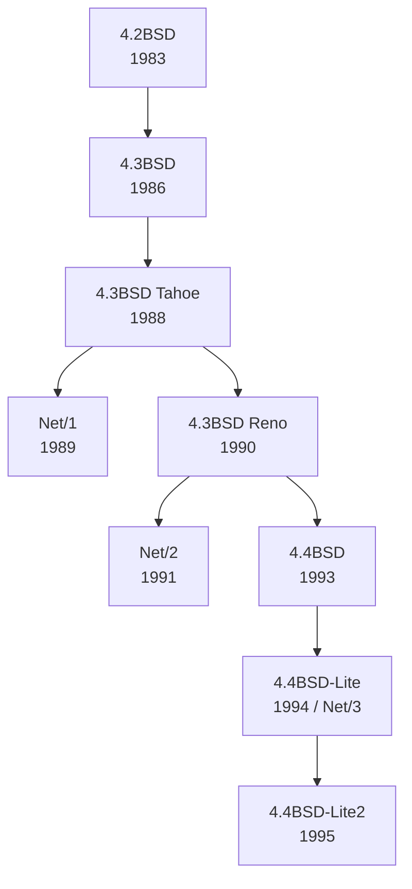

# 5. BSD networking history

## Learning goals

- Trace the historical BSD networking releases and TCP improvements.
- Explain why the redistributable networking releases mattered.

**Builds on:** [lesson 01](01_socket_boundary.md).

## Explanation

### 1.4 History of BSD Networking Releases

The sockets API was introduced in **4.2BSD (1983)** by the Computer Systems Research Group (CSRG) at UC Berkeley (spearheaded by Bill Joy, alongside pioneers like Kirk McKusick; see [Kirk McKusick's BSD History Talk](http://www.youtube.com/watch?v=ds77e3aO9nA)).

**Editorial layout repair:** Release names and dates stay in the source's branching timeline; the longer feature descriptions are preserved in the table.

| Release | Year | Source description |
| --- | ---: | --- |
| 4.2BSD | 1983 | First widely available release of TCP/IP and the sockets API. |
| 4.3BSD | 1986 | TCP performance improvements. |
| 4.3BSD Tahoe | 1988 | Slow start, congestion avoidance, and fast retransmit. |
| Net/1 | 1989 | BSD Networking Software Release 1.0. |
| 4.3BSD Reno | 1990 | Fast recovery; TCP header prediction; SLIP header compression; routing table changes; a length field added to `sockaddr{}`; control information added to `msghdr{}`. |
| Net/2 | 1991 | BSD Networking Software Release 2.0. |
| 4.4BSD | 1993 | Multicasting and long fat pipe modifications. |
| 4.4BSD-Lite / Net/3 | 1994 | Basis for BSD/OS, FreeBSD, NetBSD, and OpenBSD. |
| 4.4BSD-Lite2 | 1995 | The next release shown in the source timeline. |

Although receiving the full 4.2BSD–4.4BSD operating system distributions required an AT&T Unix source code license, **the networking releases separated redistributable Berkeley code from AT&T-licensed components.** Starting in 1989 with **Net/1**, followed by **Net/2 (1991)** and **4.4BSD-Lite / Net/3 (1994)**, Berkeley released the networking stack publicly via anonymous FTP without any AT&T license restrictions, seeding modern open-source and commercial TCP/IP stacks worldwide.

---

## Practice

No native socket API quiz questions are assigned. This teaching is retained for study and revision.

Check the [review queue](review.md) before scored practice. A lesson link can teach the reasoning that exposes a false premise or key; it does not endorse that key. Optional background is listed separately in the [manifest](manifest.json).

## Source

- [Lecture: 1.4 History of BSD Networking Releases](../../lectures/lecture_05_socket-api.md#14-history-of-bsd-networking-releases)

[Topic overview](README.md) · [Glossary](glossary.md) · [References](references.md) · [Previous lesson](04_concurrent_demultiplexing.md) · [Next lesson](06_byte_order.md)
