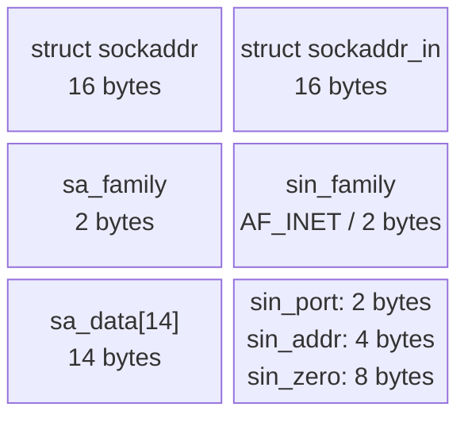

# 7. Socket address structures and storage

## Learning goals

- Distinguish IPv4 fields, generic address pointers, and protocol-independent storage.
- Retain platform layout and zero-initialization qualifications.

**Builds on:** [lesson 06](06_byte_order.md).

## Explanation

**Editorial clarification:** The source calls zero-initialization a portable convention and identifies the principal IPv4 fields separately from unused padding. Q010 overstates it as universally necessary to prevent connection errors.

### 2.2 Socket Address Structures (`sockaddr`, `sockaddr_in`, `sockaddr_storage`)

Socket address structures contain an address-family field identifying their interpretation. Its exact layout is platform-dependent: Linux begins with the family field, while BSD layouts may place a length byte before it. Use the platform headers rather than assuming a universal binary layout.

#### IPv4 Socket Address Structure (`struct sockaddr_in`)

In IPv4 (`AF_INET`), addresses are stored in `struct sockaddr_in`, which embeds `struct in_addr` for the 32-bit network-byte-ordered IPv4 address:

```c
struct in_addr {
    in_addr_t s_addr;          /* 32-bit IPv4 address, network byte ordered */
};

struct sockaddr_in {
    /* Some BSD layouts include sin_len; Linux does not. */
    sa_family_t    sin_family; /* address family: always AF_INET            */
    in_port_t      sin_port;   /* 16-bit TCP or UDP port, network byte order*/
    struct in_addr sin_addr;   /* 32-bit IPv4 address, network byte order   */
    char           sin_zero[8];/* unused padding to sizeof(struct sockaddr) */
};
```

For ordinary IPv4 setup, the principal fields are `sin_family`, `sin_port`, and `sin_addr`. Because `sin_zero` is unused padding, zero-initializing the structure before filling its fields is a good portable convention. Use the system-provided definitions; do not copy this conceptual layout as a replacement header.

#### Generic Socket Address Structure (`struct sockaddr`)

When the sockets API was designed in 1983, ANSI C did not yet have generic `void *` pointers. To allow socket system calls (`connect`, `bind`, `accept`) to accept address structures from *any* protocol family, the API defined a generic 16-byte `struct sockaddr`:

```c
struct sockaddr {
    unsigned short sa_family;   /* protocol family (2 bytes) */
    char           sa_data[14]; /* family-specific address data (14 bytes) */
};
```

**Editorial layout repair:** The source's two-column structure comparison is retained with wrapped labels. The table expands the fields and sizes for the conceptual 16-byte layout shown here; the platform-layout qualifications above still apply.



| Structure | Field | Bytes | Meaning / representation |
| --- | --- | ---: | --- |
| `struct sockaddr` | `sa_family` | 2 | Address family. |
| `struct sockaddr` | `sa_data[14]` | 14 | Family-specific address data. |
| `struct sockaddr_in` | `sin_family` | 2 | IPv4 address family, `AF_INET`. |
| `struct sockaddr_in` | `sin_port` | 2 | Port in network byte order. |
| `struct sockaddr_in` | `sin_addr` | 4 | IPv4 address in network byte order. |
| `struct sockaddr_in` | `sin_zero[8]` | 8 | Unused padding, shown zero-filled in the source. |

Whenever a socket address structure is passed to `bind()`, `connect()`, or `accept()`, it is **always passed by reference** (as a pointer) and **is normally cast to the generic pointer type `(struct sockaddr *)` (or its const-qualified form)** (often abbreviated in textbook code via `#define SA struct sockaddr`).

#### Protocol-Independent Storage (`struct sockaddr_storage`)

Because IPv6 (`struct sockaddr_in6`, 28 bytes) and Unix domain sockets (`struct sockaddr_un`) are larger than the 16-byte IPv4 `struct sockaddr_in`, modern protocol-independent programs should allocate **`struct sockaddr_storage`**, which is guaranteed to be large enough and properly aligned to hold any socket address family supported by the system.

## Practice

- **Q010** in [quiz 05](../../quizzes/quiz_05_socket_api.json); flags: `wording_issue`.
- **Q019** in [quiz 05](../../quizzes/quiz_05_socket_api.json).

Check the [review queue](review.md) before scored practice. A lesson link can teach the reasoning that exposes a false premise or key; it does not endorse that key. Optional background is listed separately in the [manifest](manifest.json).

## Source

- [Lecture: 2.2 Socket Address Structures (`sockaddr`, `sockaddr_in`, `sockaddr_storage`)](../../lectures/lecture_05_socket-api.md#22-socket-address-structures-sockaddr-sockaddr_in-sockaddr_storage)

[Topic overview](README.md) · [Glossary](glossary.md) · [References](references.md) · [Previous lesson](06_byte_order.md) · [Next lesson](08_address_conversion.md)
