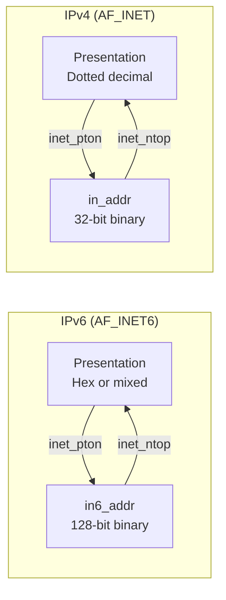

# 8. IP presentation and numeric conversion

## Learning goals

- Choose modern IPv4/IPv6 conversion functions.
- Interpret their success, invalid-input, and error returns.

**Builds on:** [lesson 07](07_address_structures.md).

## Explanation

### 2.3 IP Address Conversion (`inet_pton`, `inet_ntop`, `sock_ntop`) and DNS Resolution

Humans prefer readable ASCII presentation strings (such as dotted-decimal `"206.168.112.219"` or IPv6 hex `"x:x:x:x:x:x:x:x"`), whereas socket structures require binary numeric values in network byte order.

**Editorial layout repair:** The source's IPv4 and IPv6 panels are stacked vertically. Node labels are wrapped, and the tables retain the full notation and API details. Each panel shows text/binary conversion within its address family.



| Family | Presentation examples from the source | Numeric form |
| --- | --- | --- |
| IPv4 | `a.b.c.d` | `struct in_addr`, 32-bit binary address |
| IPv6 | `x:x:x:x:x:x:x:x`<br/>or `x:x:x:x:x:x:a.b.c.d` | `struct in6_addr`, 128-bit binary address |

| Family | Arrow label | Full APIs represented |
| --- | --- | --- |
| IPv4 | `inet_pton` (text to binary) | `inet_pton(AF_INET)`<br/>Legacy: `inet_aton()`, `inet_addr()` |
| IPv4 | `inet_ntop` (binary to text) | `inet_ntop(AF_INET)`<br/>Legacy: `inet_ntoa()` |
| IPv6 | `inet_pton` (text to binary) | `inet_pton(AF_INET6)` |
| IPv6 | `inet_ntop` (binary to text) | `inet_ntop(AF_INET6)` |

* **Legacy IPv4-only functions:** `inet_aton()`, `inet_addr()`, and `inet_ntoa()` convert only IPv4 addresses and appear frequently in older code.
* **Modern protocol-independent functions (`inet_pton` and `inet_ntop`):** The letters **`p`** and **`n`** stand for **presentation** (ASCII string) and **numeric** (binary network-byte-ordered structure):

```c
int inet_pton(int family, const char *strptr, void *addrptr);
/* Returns: 1 if OK, 0 if input is not a valid presentation format, -1 on error */

const char *inet_ntop(int family, const void *addrptr, char *strptr, size_t len);
/* Returns: pointer to result string if OK, NULL on error */
```

## Practice

- **Q018** in [quiz 05](../../quizzes/quiz_05_socket_api.json); flags: `wording_issue`.

Check the [review queue](review.md) before scored practice. A lesson link can teach the reasoning that exposes a false premise or key; it does not endorse that key. Optional background is listed separately in the [manifest](manifest.json).

## Source

- [Lecture: 2.3 IP Address Conversion (`inet_pton`, `inet_ntop`, `sock_ntop`) and DNS Resolution](../../lectures/lecture_05_socket-api.md#23-ip-address-conversion-inet_pton-inet_ntop-sock_ntop-and-dns-resolution)

[Topic overview](README.md) · [Glossary](glossary.md) · [References](references.md) · [Previous lesson](07_address_structures.md) · [Next lesson](09_socket_formatting.md)
