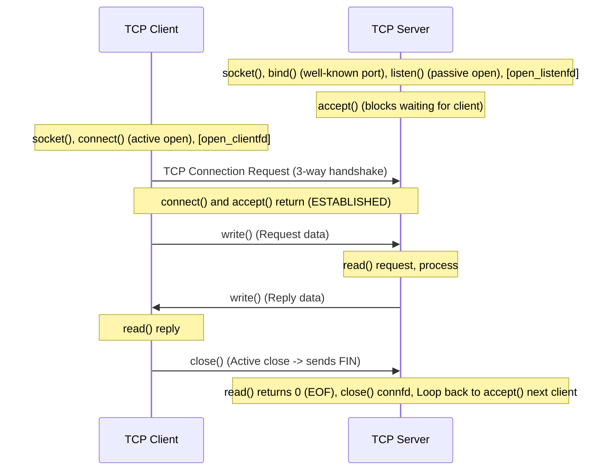

# 11. A blocking TCP client-server session

## Learning goals

- Trace setup, requests, replies, and close across client and server.
- Distinguish kernel handshakes from application accept timing.

**Builds on:** [lesson 02](02_clients_and_socket_pairs.md).

## Explanation

## 3. Elementary TCP Sockets and the Daytime Client/Server

### 3.1 Overview of a TCP Client-Server Session

A typical blocking TCP client-server interaction follows this sequence. The kernel completes handshakes independently of when the application calls `accept()`:

## Practice

No native socket API quiz questions are assigned. This teaching is retained for study and revision.

Check the [review queue](review.md) before scored practice. A lesson link can teach the reasoning that exposes a false premise or key; it does not endorse that key. Optional background is listed separately in the [manifest](manifest.json).

## Source

- [Lecture: 3. Elementary TCP Sockets and the Daytime Client/Server](../../lectures/lecture_05_socket-api.md#3-elementary-tcp-sockets-and-the-daytime-clientserver)

[Topic overview](README.md) · [Glossary](glossary.md) · [References](references.md) · [Previous lesson](10_name_resolution.md) · [Next lesson](12_socket_call.md)
