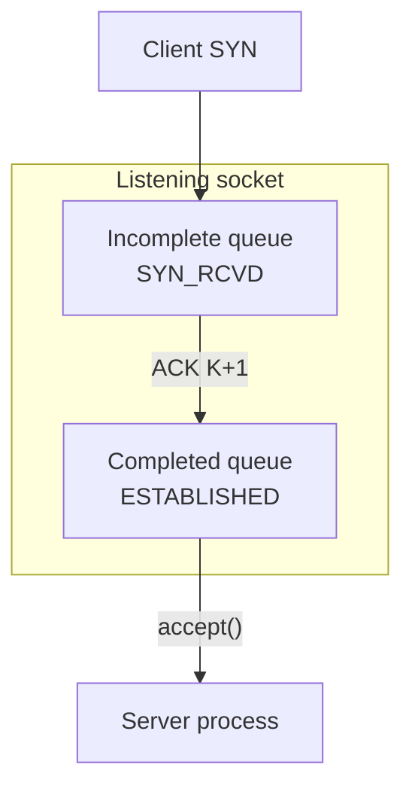

# 20. Three-way handshake and listen queues

## Learning goals

- Trace SYN/SYN+ACK/ACK and the endpoint states.
- Distinguish incomplete and completed queues and historical/Linux backlog meanings.

**Builds on:** [lesson 13](13_connect_call.md), [lesson 15](15_listen_call.md), [lesson 16](16_accept_call.md).

## Explanation

## 4. TCP Connection Establishment, Termination, and State Transitions

### 4.1 The Three-Way Handshake and Kernel Listen Queues

Establishing a TCP connection requires a **three-way handshake**:

1. **Passive Open (Server):** The server calls `socket()`, `bind()`, and `listen()`, placing its socket in the `LISTEN` state, and blocks in `accept()`.
2. **Segment 1 — `SYN J` (Client $\to$ Server):** The client calls `connect()` (an **active open**), causing its kernel to send a `SYN` segment carrying the client's initial sequence number $J$ (along with TCP options such as $\text{MSS}$; this example assumes an ordinary handshake without SYN data). The client enters `SYN_SENT`.
3. **Segment 2 — `SYN K, ACK J+1` (Server $\to$ Client):** Upon receiving `SYN J`, the server kernel creates an entry in its **incomplete connection queue**, copies the listening socket's parameters to the embryonic connection, transitions it to `SYN_RCVD`, and replies with a single segment containing its own `SYN` (initial sequence number $K$) and `ACK J+1`. *Notice that the server application process is not woken up yet.*
4. **Segment 3 — `ACK K+1` (Client $\to$ Server):** When the client receives `SYN K, ACK J+1`, **blocking `connect()` can complete** (roughly one RTT without loss), the client enters `ESTABLISHED`, and the client's kernel sends `ACK K+1`. When `ACK K+1` arrives at the server, the kernel moves the connection from the **incomplete connection queue (`SYN_RCVD`)** to the **completed connection queue (`ESTABLISHED`)**, and **`accept()` wakes up and returns `connfd`**.

**Editorial layout repair:** The source queue sequence runs top to bottom with wrapped labels. The table preserves each stage's full meaning.

| Stage / arrow | Meaning |
| --- | --- |
| Client SYN | An arriving SYN creates an incomplete connection entry. |
| Incomplete queue | `SYN_RCVD`: awaiting the third handshake segment or a handshake timeout. |
| `ACK K+1` | Arrival of the third handshake segment completes the handshake and moves the entry to the completed queue. |
| Completed queue | `ESTABLISHED`: the three-way handshake is complete; the connection awaits application acceptance. |
| `accept()` | Dequeues the front completed entry for the server process and returns `connfd`. |

* **What does `backlog` in `listen(sockfd, backlog)` mean?** Historically in BSD, `backlog` specified the maximum allowed **sum of both queues** (incomplete + completed), with some implementations applying an additional factor. **On modern Linux, backlog limits the queue of established connections waiting for acceptance; the incomplete SYN queue is governed separately.** The requested backlog can also be capped by system settings. See [listen(2)](https://man7.org/linux/man-pages/man2/listen.2.html).

## Practice

- **Q065** in [quiz 05](../../quizzes/quiz_05_socket_api.json).

Check the [review queue](review.md) before scored practice. A lesson link can teach the reasoning that exposes a false premise or key; it does not endorse that key. Optional background is listed separately in the [manifest](manifest.json).

## Source

- [Lecture: 4. TCP Connection Establishment, Termination, and State Transitions](../../lectures/lecture_05_socket-api.md#4-tcp-connection-establishment-termination-and-state-transitions)

[Topic overview](README.md) · [Glossary](glossary.md) · [References](references.md) · [Previous lesson](19_daytime_server.md) · [Next lesson](21_orderly_teardown.md)
