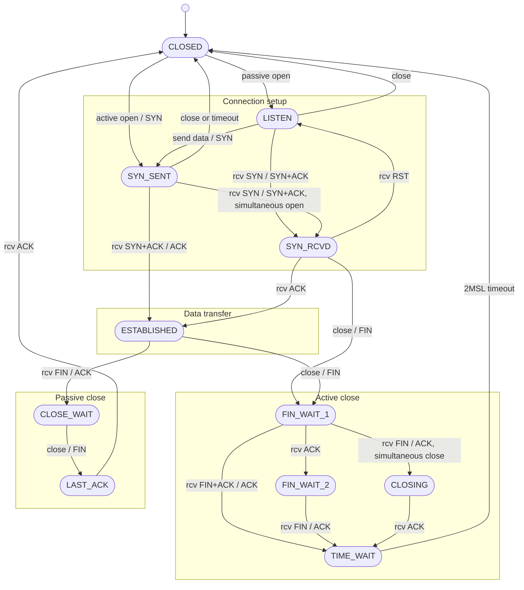

# 22. TCP states and simultaneous open or close

## Learning goals

- Follow ordinary setup and teardown states.
- Trace the simultaneous-open and simultaneous-close paths.

**Builds on:** [lesson 20](20_handshake_and_queues.md), [lesson 21](21_orderly_teardown.md).

## Explanation

### 4.3 TCP State Transitions and Packet Trace

Notice the two special edge cases captured in the state machine:
* **Simultaneous open (`SYN_SENT` $\to$ `SYN_RCVD`):** Both ends perform an active open at nearly the same instant and their `SYN`s cross in the network.
* **Simultaneous close (`FIN_WAIT_1` $\to$ `CLOSING` $\to$ `TIME_WAIT`):** Both applications call `close()` simultaneously while in `ESTABLISHED`, and their `FIN`s cross in the network.

## Practice

- **Q008** in [quiz 05](../../quizzes/quiz_05_socket_api.json).

Check the [review queue](review.md) before scored practice. A lesson link can teach the reasoning that exposes a false premise or key; it does not endorse that key. Optional background is listed separately in the [manifest](manifest.json).

## Source

- [Lecture: 4.3 TCP State Transitions and Packet Trace](../../lectures/lecture_05_socket-api.md#43-tcp-state-transitions-and-packet-trace)

[Topic overview](README.md) · [Glossary](glossary.md) · [References](references.md) · [Previous lesson](21_orderly_teardown.md) · [Next lesson](23_time_wait.md)
