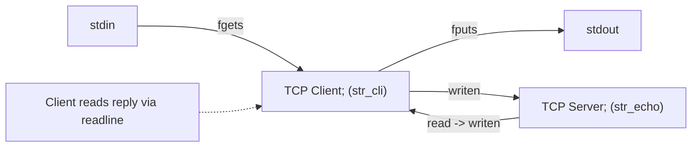

# 28. The baseline echo server

## Learning goals

- Trace the accept/read/echo/close loop and EINTR handling.
- Identify the iterative server behavior.

**Builds on:** [lesson 16](16_accept_call.md), [lesson 18](18_wrappers_and_daytime_client.md), [lesson 19](19_daytime_server.md), [lesson 26](26_writen.md).

## Explanation

**Code context:** The C listings are teaching fragments using the course support definitions and capitalized wrappers described in [lesson 18](18_wrappers_and_daytime_client.md).

### 5.3 The Baseline TCP Echo Server and Client (`str_echo` and `str_cli`)



#### Baseline Echo Server (`main` and `str_echo`)

```c
int main(int argc, char **argv) {
    int                listenfd, connfd;
    socklen_t          clilen;
    struct sockaddr_in cliaddr, servaddr;

    listenfd = Socket(AF_INET, SOCK_STREAM, 0);
    bzero(&servaddr, sizeof(servaddr));
    servaddr.sin_family      = AF_INET;
    servaddr.sin_addr.s_addr = htonl(INADDR_ANY);
    servaddr.sin_port        = htons(7); /* or SERV_PORT */

    Bind(listenfd, (SA *) &servaddr, sizeof(servaddr));
    Listen(listenfd, LISTENQ);

    for ( ; ; ) {
        clilen = sizeof(cliaddr);
        connfd = Accept(listenfd, (SA *) &cliaddr, &clilen);
        str_echo(connfd);
        Close(connfd);
    }
}

void str_echo(int sockfd) {
    ssize_t n;
    char    buf[MAXLINE];
again:
    while ((n = read(sockfd, buf, MAXLINE)) > 0)
        Writen(sockfd, buf, n);
    if (n < 0 && errno == EINTR)
        goto again;
    else if (n < 0)
        err_sys("str_echo: read error");
}
```

## Practice

No native socket API quiz questions are assigned. This teaching is retained for study and revision.

Check the [review queue](review.md) before scored practice. A lesson link can teach the reasoning that exposes a false premise or key; it does not endorse that key. Optional background is listed separately in the [manifest](manifest.json).

## Source

- [Lecture: 5.3 The Baseline TCP Echo Server and Client (`str_echo` and `str_cli`)](../../lectures/lecture_05_socket-api.md#53-the-baseline-tcp-echo-server-and-client-str_echo-and-str_cli)

[Topic overview](README.md) · [Glossary](glossary.md) · [References](references.md) · [Previous lesson](27_buffered_readline.md) · [Next lesson](29_baseline_echo_client.md)
