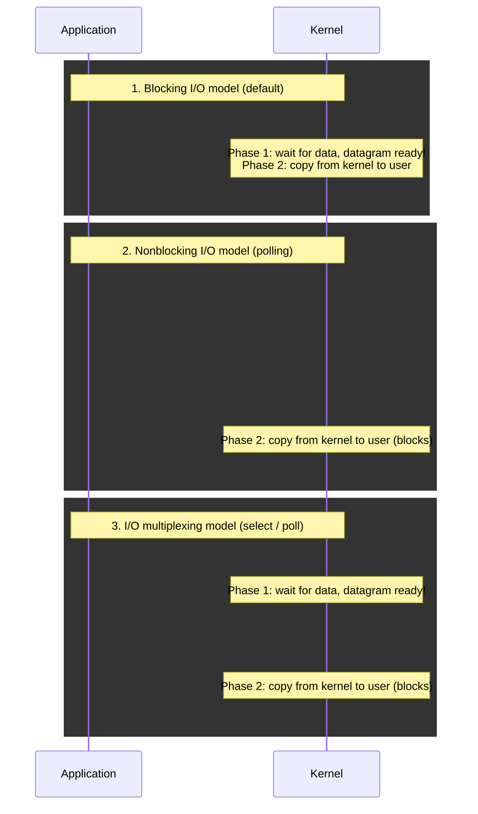

# 30. Blocking, nonblocking, and multiplexed I/O

## Learning goals

- Separate waiting for input from transferring it to user space.
- Compare polling, readiness multiplexing, and asynchronous completion.

**Builds on:** [lesson 29](29_baseline_echo_client.md).

## Explanation

## 6. I/O Models, I/O Multiplexing (`select`), and Batch Input

### 6.1 Comparing Unix I/O Models

Every input operation on a socket involves **two distinct phases**:
1. **Phase 1:** Waiting for data to arrive from the network and be placed into a kernel buffer.
2. **Phase 2:** Copying the data from the kernel buffer into the application's user-space buffer.

The classical taxonomy distinguishes five models: blocking, nonblocking, I/O multiplexing, signal-driven, and asynchronous I/O. The next diagram compares the first three, in which a separate read receives the data. **Asynchronous I/O differs:** completion notification can follow both waiting and data transfer. The later io_uring discussion extends the lecture beyond readiness-based examples.

When should an application use **I/O Multiplexing**?
* When a client handles multiple descriptors simultaneously (e.g., interactive `stdin` + a network socket, or multiple concurrent sockets).
* When a single-process TCP server handles both its listening socket and multiple connected client sockets.
* When a server handles both TCP and UDP, or multiple services/protocols at once.

## Practice

- **Q035** in [quiz 05](../../quizzes/quiz_05_socket_api.json).
- **Q075** in [quiz 05](../../quizzes/quiz_05_socket_api.json); flags: `wording_issue`.

Check the [review queue](review.md) before scored practice. A lesson link can teach the reasoning that exposes a false premise or key; it does not endorse that key. Optional background is listed separately in the [manifest](manifest.json).

## Source

- [Lecture: 6. I/O Models, I/O Multiplexing (`select`), and Batch Input](../../lectures/lecture_05_socket-api.md#6-io-models-io-multiplexing-select-and-batch-input)

[Topic overview](README.md) · [Glossary](glossary.md) · [References](references.md) · [Previous lesson](29_baseline_echo_client.md) · [Next lesson](31_select_readiness.md)
