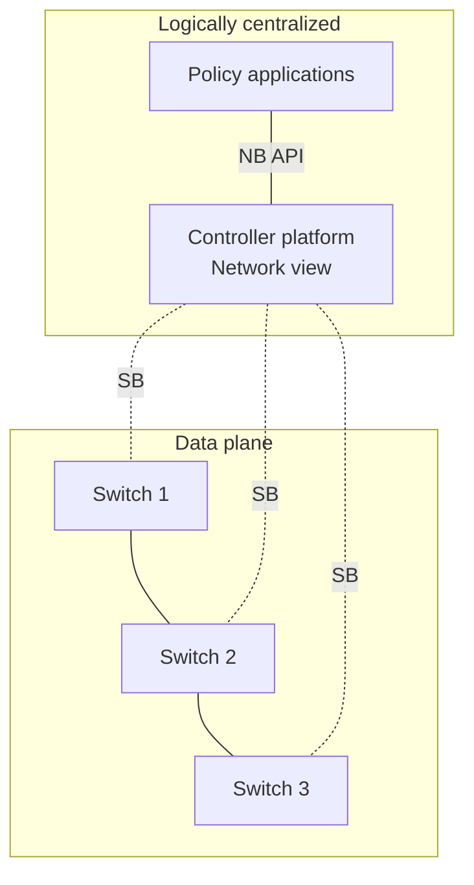

# 1. SDN separation, logical centralization, and interfaces

## Learning goals

- Distinguish logical centralization from a single controller machine.
- Locate northbound and southbound interfaces and distributed forwarding.

## Explanation

## 1. What is Software Defined Networking (SDN)?

### 1.1 Core Definition and Architectural Shift

A **Software Defined Network (SDN)** is defined by two fundamental architectural properties:

1. **Separation of control and forwarding:** Control logic is decoupled from packet forwarding, commonly running on separate controller servers in the architecture studied here.
2. **Logically centralized control:** A single (**logically centralized**, though often physically distributed for reliability and scale) control plane controls multiple forwarding devices across the network.

In a traditional network, routers and switches typically combine local control software with packet forwarding, running distributed algorithms to exchange state with neighbors. In contrast, SDN extracts the control intelligence out of the individual switches and consolidates it into a **Network Operating System (Network OS)** that maintains a **Global Network Map** and exposes programmatic interfaces to high-level **Control Programs**:

**Editorial label repair:** The source architecture and connections are retained; line breaks and short interface labels reduce crowding.

| Label | Full meaning |
| --- | --- |
| NB API | Northbound API between policy applications and the controller platform/network view |
| SB | Southbound control relationship between that platform and each forwarding switch |

Solid switch links denote data-plane connectivity; dotted links denote logical control relationships, which can share or use separate physical links. A traditional design instead places cooperating control processes in the routers themselves. Logical centralization does not require a single controller machine.

As illustrated in the canonical SDN layering model (e.g., Nencioni et al., 2017), the **Control Plane** (implemented by one or more SDN controllers) sits in the middle between two well-defined boundaries:

* **Northbound Interface:** Connects the SDN controller(s) upward to **Network Applications (Control Programs)** that define routing, security, and traffic-engineering policies.
* **Southbound Interface:** Connects the SDN controller(s) downward to the **Network Devices** in the **Data Plane** that forward packets.

## Practice

Use [quiz 06](../../quizzes/quiz_06_sdn.json); Q-numbers retain the original question order.

- **Q001** (`sdn-q001`). No additional required lesson.
- **Q002** (`sdn-q002`). No additional required lesson.
- **Q003** (`sdn-q003`). No additional required lesson.

## Source

- [Lecture: 1.1 Core Definition and Architectural Shift](../../lectures/lecture_06_sdn.md#11-core-definition-and-architectural-shift)

[Topic overview](README.md) · [Glossary](glossary.md) · [References](references.md) · [Next lesson](02_adoption.md)
