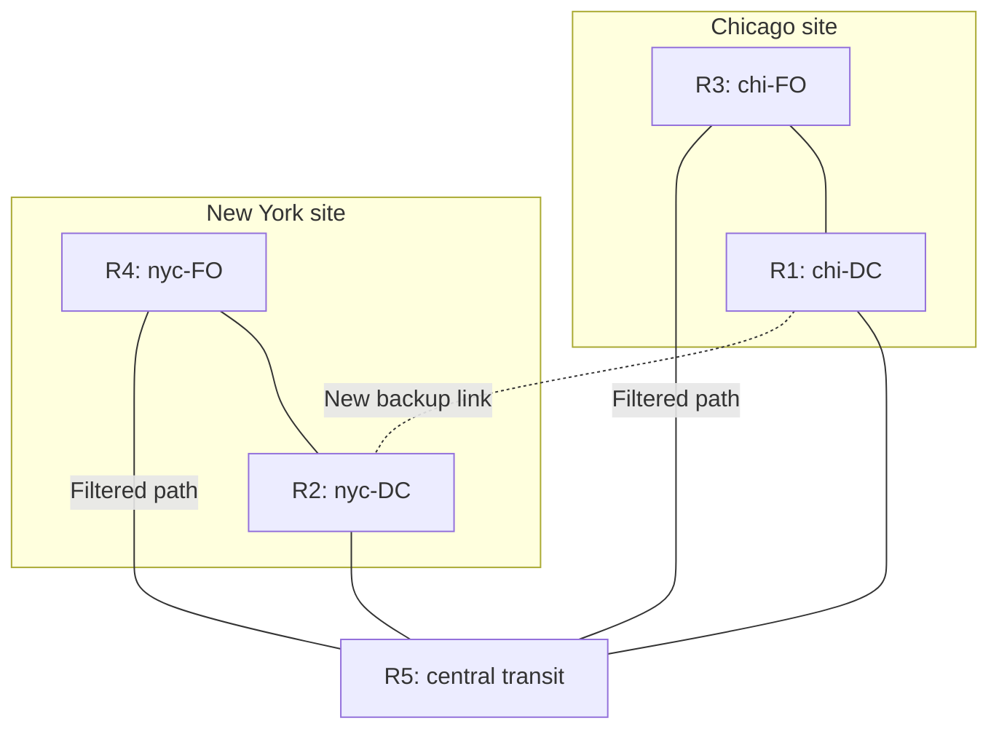

# 6. How a new route can bypass a packet filter

## Learning goals

- Trace the R3 to R1 to R2 bypass and identify the skipped filter.
- Retain the example's narrower policy scope and the need for safe rule placement.

## Explanation

### 2.5 Motivating Case Study 2: Distributed Access Control Failure

A routing change can create a path that bypasses an existing packet filter. The lecture example uses Chicago and New York front-office networks (`chi-FO`, `nyc-FO`), data centers (`chi-DC`, `nyc-DC`), routers R1–R4, and a central transit router R5.

**Scope of the example:** The supplied guide says all front-office traffic must be barred from all data centers, but also draws direct local front-office/data-center links without explaining their filters. Those details do not establish the broad policy. The narrower failure demonstrated below is **chi-FO gaining a bypass path to nyc-DC**; local access controls remain unspecified.

Initially, cross-site traffic is intended to traverse the filtered path through R5. The illustrated interface policy blocks front-office-source traffic on that path (`Drop chi-FO → *; Permit other traffic`, with a corresponding New York rule). These are directional interface rules, not restrictions inherent in the physical links.

All connectors represent connectivity. The dotted connection is the added backup link, not an arrow showing packet flow. After it is introduced:

1. Routing may select **R3 → R1 → R2** for chi-FO traffic to nyc-DC, depending on link costs and policy.
2. That path avoids the filter on the route through R5.
3. Reachability updates automatically, but the separately configured ACL does not automatically follow the new path.
4. The intended cross-site restriction can therefore fail while the routing protocol is behaving correctly.

SDN can express the restriction centrally and derive rules for every permitted path. This is a capability of a correctly implemented policy application, **not an automatic security guarantee from using SDN**. The controller must also handle topology discovery, rule-placement coverage, and safe update ordering.

---

## Practice

Use [quiz 06](../../quizzes/quiz_06_sdn.json); Q-numbers retain the original question order.

- **Q009** (`sdn-q009`). No additional required lesson.

## Source

- [Lecture: 2.5 Motivating Case Study 2: Distributed Access Control Failure](../../lectures/lecture_06_sdn.md#25-motivating-case-study-2-distributed-access-control-failure)

[Topic overview](README.md) · [Glossary](glossary.md) · [References](references.md) · [Previous lesson](05_bgp_policy_limits.md) · [Next lesson](07_open_network_stack.md)
