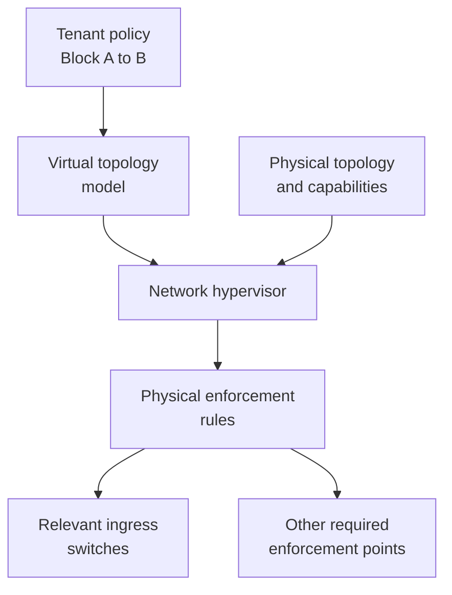

# 10. Virtual topologies and physical policy enforcement

## Learning goals

- Trace a tenant policy through a virtual topology to physical enforcement rules.
- Explain ingress placement, path coverage, and tenant isolation.

## Explanation

#### Translating Virtual Policies to Physical Rules
Above the Network OS, a **Network Hypervisor** can interpose an **Abstract Network View (Virtual Topology)** between the physical **Global Network View** and the **Control Program**:

**Editorial label repair:** Explicit line breaks retain the source's full labels and translation dependencies in its vertical layout.

Arrows show translation dependencies and rule installation, not a physical packet path. A tenant may see one virtual switch even when its traffic traverses several physical switches.

* Suppose a Control Program only cares about enforcing an access-control policy between `Host A` and `Host B`. The Network Hypervisor presents the Control Program with an **Abstract Network View** consisting of a single logical switch connecting `A` and `B`.
* The Control Program simply issues a single rule on that virtual switch: `A -> B : drop`.
* The **Network Hypervisor** translates the virtual policy into physical enforcement rules. A drop rule may only need enforcement at trusted ingress points, rather than on every switch; placement must cover all allowed paths and preserve tenant isolation.

## Practice

Use [quiz 06](../../quizzes/quiz_06_sdn.json); Q-numbers retain the original question order.

- **Q013** (`sdn-q013`). No additional required lesson.
- **Q019** (`sdn-q019`). No additional required lesson.
- **Q024** (`sdn-q024`). No additional required lesson.
- **Q025** (`sdn-q025`). Additional required reading: [sdn-12](12_match_action_tables.md).

## Source

- [Lecture: Translating Virtual Policies to Physical Rules](../../lectures/lecture_06_sdn.md#translating-virtual-policies-to-physical-rules)

[Topic overview](README.md) · [Glossary](glossary.md) · [References](references.md) · [Previous lesson](09_forwarding_abstraction.md) · [Next lesson](11_reusable_complexity.md)
