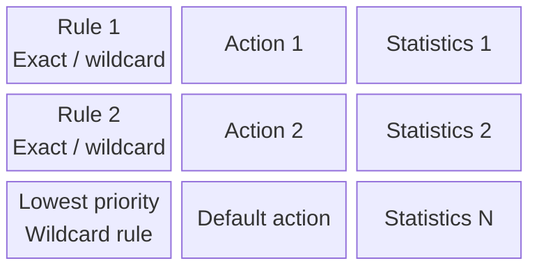

# 12. OpenFlow matches, actions, counters, and capabilities

## Learning goals

- Interpret match, action, and statistics fields with priority and hardware limits.
- Recognize rewriting, forwarding to several ports, dropping, and controller delivery.

## Explanation

## 4. OpenFlow Protocol Basics and Execution Walkthrough

### 4.1 The `<Match, Action>` Primitive and Switch Flow Tables

**OpenFlow** is a southbound protocol studied in this lecture linking the **Control Path** (the Network OS and Control Programs) to the **Data Path** (the hardware Flow Tables inside Ethernet switches and routers).

OpenFlow generalizes existing hardware forwarding tables (such as L2 MAC tables, L3 IP routing tables, and ACL TCAMs) into a unified **`<Match, Action>`** primitive:

**Editorial label repair:** The original three-column block diagram keeps the rule/action/statistics alignment. Full entry details are moved beside the diagram.

| Entry | Rule / match | Action | Statistics |
| --- | --- | --- | --- |
| 1 | Exact and wildcard match; e.g. `1000x01xx0101001x` | Forward, drop, send to controller, or modify | Packet and byte counters |
| 2 | Exact and wildcard match | Action 2 | Statistics 2 |
| N | Lowest-priority wildcard rule | Default action, e.g. send to controller or drop | Statistics N |

The lecture groups an entry into three conceptual parts. Real entries also have priority, timers, and other metadata; later OpenFlow versions use instructions and multi-table pipelines:

1. **Rule (Match):** Matches supported fields across L2/L3/L4 packet headers using **exact bits** (`0`, `1`) and **wildcard bits** (`x` / "don't care", e.g., `1000x01xx0101001x`). This can represent several granularities, such as a five-tuple, prefix, or VLAN. Available fields and masks depend on the OpenFlow version and switch capabilities; OpenFlow is not an unrestricted arbitrary-bit parser.
2. **Action:** Specifies what to do with matching packets:
   * **Forward to port(s):** e.g., *"If header $= p$, send to port 4"* (unicast) or *"send to ports 5, 6"* (multicast/flood).
   * **Send to controller:** e.g., *"If header $= \text{?}$, encapsulate in `Packet-IN` and send to me (the controller)."*
   * **Drop:** Silently discard the packet.
   * **Header rewrite / encapsulation:** e.g., *"If header $= q$, overwrite header with $r$ (using a mask), push or pop a header $s$ (VLAN/MPLS), and send to ports 5, 6."*
   * **Rate-limit / Queue:** Select a configured output queue or use supported metering actions. Queue selection alone is not a guaranteed bit rate.
3. **Statistics:** Hardware counters tracking the number of matching packets and bytes (used by the controller for traffic monitoring and accounting).

## Practice

Use [quiz 06](../../quizzes/quiz_06_sdn.json); Q-numbers retain the original question order.

- **Q005** (`sdn-q005`). No additional required lesson.
- **Q007** (`sdn-q007`). No additional required lesson. **Wording review:** See the [review queue](review.md#wording-and-answer-key-findings) before scoring; the preserved key needs qualification.
- **Q011** (`sdn-q011`). No additional required lesson.
- **Q012** (`sdn-q012`). No additional required lesson.
- **Q022** (`sdn-q022`). No additional required lesson.

## Source

- [Lecture: 4.1 The `<Match, Action>` Primitive and Switch Flow Tables](../../lectures/lecture_06_sdn.md#41-the-match-action-primitive-and-switch-flow-tables)

[Topic overview](README.md) · [Glossary](glossary.md) · [References](references.md) · [Previous lesson](11_reusable_complexity.md) · [Next lesson](13_table_misses.md)
