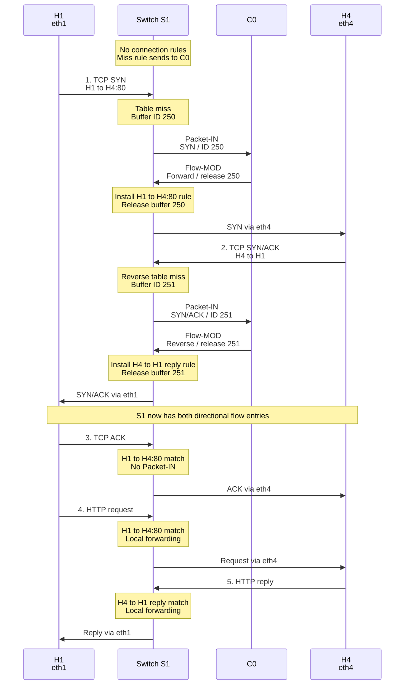

# 15. A reactive TCP and HTTP exchange

## Learning goals

- Trace separate forward and reverse rule installation.
- Explain when subsequent traffic stays in the switch and when control may be needed again.

## Explanation

**Editorial context from the source example:** S1 connects H1/H2/H3/H4 on eth1/eth2/eth3/eth4; C0 controls it. Addresses and link-layer reachability are already resolved. A configured miss rule sends unmatched packets to C0, and buffering is supported in this example. This sequence uses [lesson 14](14_controller_responses.md)'s reactive Flow-MOD option.

#### Complete End-to-End Sequence (Reactive `Flow-MOD` Mode)

**Editorial label repair:** The source participant order and message sequence are retained. Short participant names and explicit line breaks keep notes and messages compact.

| Label / phase | Full meaning |
| --- | --- |
| H1 / H4 | Client host H1 on S1 port eth1 / server host H4 on S1 port eth4 |
| S1 / C0 | OpenFlow switch S1 / OpenFlow controller C0 |
| Buffer 250 | Initial H1-to-H4 TCP SYN, destination port 80; the forward Flow-MOD installs its flow entry and releases the buffered packet |
| Buffer 251 | Reverse H4-to-H1 TCP SYN/ACK; the reverse Flow-MOD installs the reply flow entry and releases that packet |
| Steps 3–5 | TCP ACK and HTTP request match the H1-to-H4 port-80 entry; HTTP reply matches the reverse entry. All three forward locally, using eth4 toward H4 and eth1 toward H1 |

Notice the crucial transition after the `SYN` and `SYN/ACK` install the forward (`H1->H4 Port 80`) and reverse (`H4->H1 Reply`) flow entries: **subsequent matching packets can be forwarded locally while those rules remain valid. Rule expiry, a topology change, a different match, or an explicit controller action can require further control-plane involvement. Hardware capability determines actual forwarding performance.**

## Practice

No native quiz question has this lesson as its primary assignment. The source teaching remains included; this lesson may provide required or optional support listed in the [manifest](manifest.json).

## Source

- [Lecture: Complete End-to-End Sequence (Reactive `Flow-MOD` Mode)](../../lectures/lecture_06_sdn.md#complete-end-to-end-sequence-reactive-flow-mod-mode)

[Topic overview](README.md) · [Glossary](glossary.md) · [References](references.md) · [Previous lesson](14_controller_responses.md) · [Next lesson](16_control_paths.md)
